<!--
author:   Luka Colarič
email:    luka.colaric@sckr.si
version:  1.4.0
language: sl
comment:  MAKE&LEARN. Usposabljanje učiteljev, 28.–30. 10. 2026, ŠC Kranj, MladLab.
          Ta tečaj je hkrati primer: vse, kar vidite, je en sam markdown v LiaScriptu.
logo:     img/art_tangram.png
tags:     MAKE&LEARN, Erasmus+, učila, LiaScript
translation: Srpski  README.sr.md
-->

# Od ideje do učila

**MAKE&LEARN** · usposabljanje učiteljev
28.–30. 10. 2026 · ŠC Kranj, MladLab · 9.00–12.30

V treh dneh v paru razvijete eno učilo za svoj predmet. Programiranje ni potrebno.

**Slovenščina** · [Srpski](https://liascript.github.io/course/?https://raw.githubusercontent.com/Pfyber/LiaShow/main/README.sr.md)

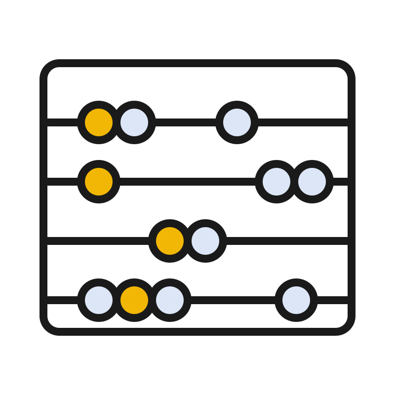<!-- style="width:120px" -->
<!-- style="width:120px" -->


# 1. dan: od ideje do aplikacije

| Ura   | Blok                           |
| ----- | ------------------------------ |
| 9.00  | Dobrodošli                     |
| 9.10  | Spoznavanje in pari            |
| 9.25  | Ugani učilo                    |
| 9.40  | Projekt in zgodovina učil      |
| 10.00 | Iskanje idej                   |
| 10.40 | Odmor                          |
| 10.55 | Spletna aplikacija             |
| 11.30 | Objava na GitHub Pages         |
| 11.55 | Interaktivni delovni zvezek    |
| 12.20 | Zaključek dneva                |


## Dobrodošli

_10 min_

V treh dneh v paru naredite več stvari, ki jih lahko takoj uporabite pri pouku.

- Vsaka je uporabna sama zase.
- Lahko so na isto temo, ni pa nujno.


|                                            | Kaj odnesete                    | Kaj je                                                       | Kdaj   |
| ------------------------------------------ | ------------------------------- | ------------------------------------------------------------ | ------ |
| 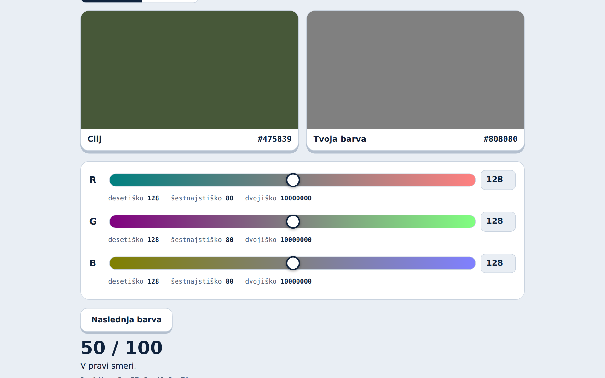<!-- style="height:60px" --> | spletna aplikacija              | digitalno učilo: igra, simulacija ali vaja na spletu         | 1. dan |
| 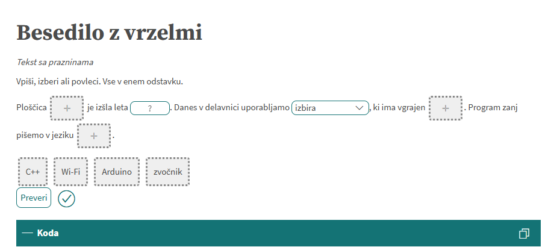<!-- style="height:60px" --> | interaktivni delovni zvezek     | vaš učbenik ali delovni list, izboljšan s kvizi in razlago   | 1. dan |
| <!-- style="height:60px" --> | fizično učilo                   | izdelek iz makerspacea: 3D-tisk, laser, karton               | 2. dan |
| 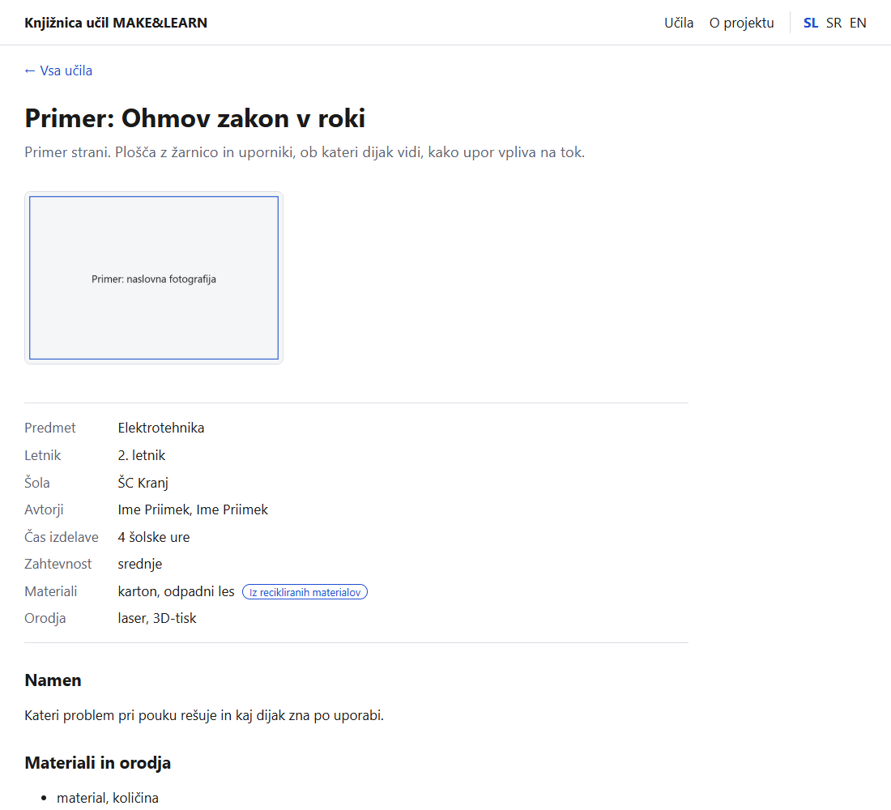<!-- style="height:60px" --> | stran v knjižnici in načrt      | da učilo ponovijo drugi in z njim delajo vaši dijaki         | 3. dan |

Za vse to ne potrebujete znanja programiranja. Kodo napiše AI, vi poskrbite za vsebino.

**Potrebujete:** prenosnik, GitHub račun s potrjenim e-naslovom, dostop do AI (ChatGPT, Claude, Gemini ali Copilot). Ta tečaj imejte odprt ves čas.


## Spoznavanje in pari

_15 min_

**Rezultat:** par za vse tri dni in predmet, za katerega bosta naredila učilo.

1. **Krog:** ime, šola, predmet in najboljše učilo, ki se ga spomnite iz šole. Ena minuta na osebo.
2. **Par:** poiščite nekoga iz druge šole, s čim bolj sorodnim predmetom.
3. **Predmet:** dogovorita se, za čigav predmet bo učilo, ali poiščita temo, ki je skupna obema.
4. Sedita skupaj in oba odprita ta tečaj.

En par, eno učilo. Akcijski načrt na koncu napiše vsak zase, za svoj razred.


## Ugani učilo

_15 min · v paru_

Ogrevanje. Osem resničnih učil iz zgodovine: vsako je nekdo naredil, da bi razložil eno stvar. Za vsako izberite ime, nato vsa razvrstite od najstarejšega do najnovejšega.

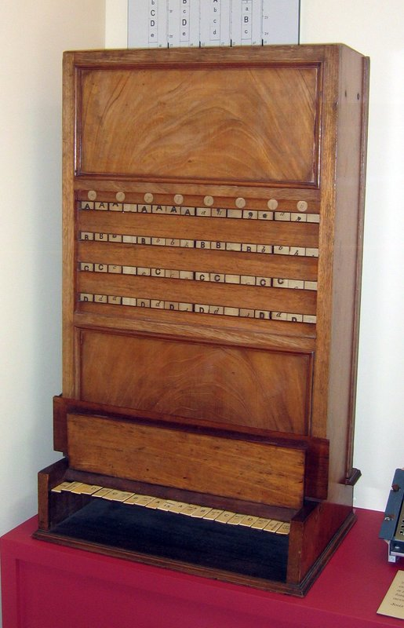
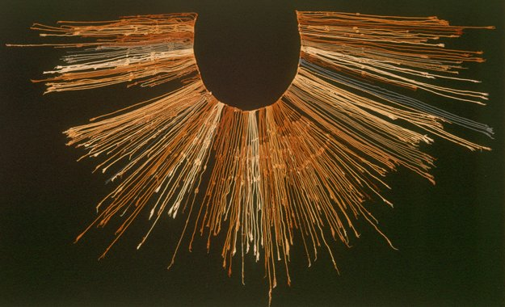
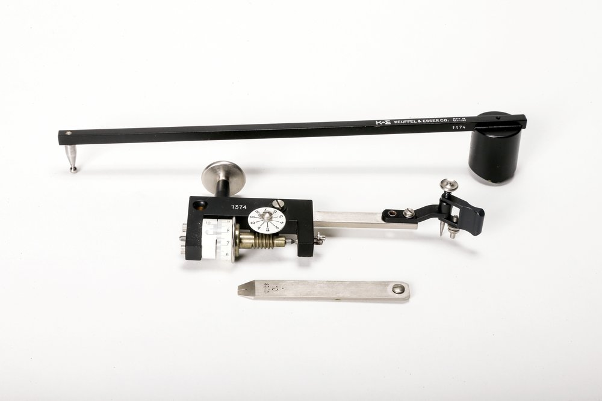
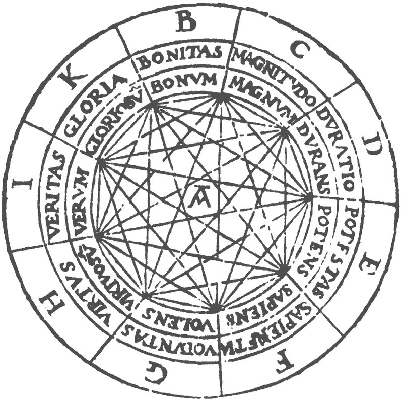
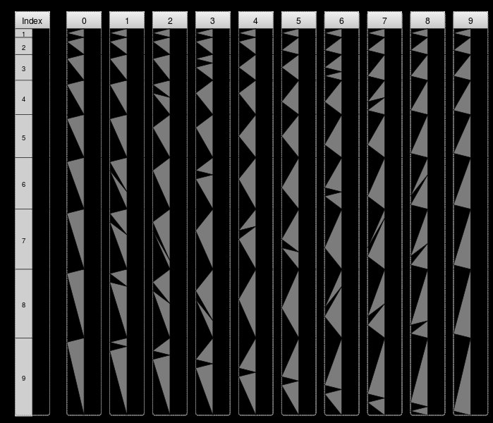
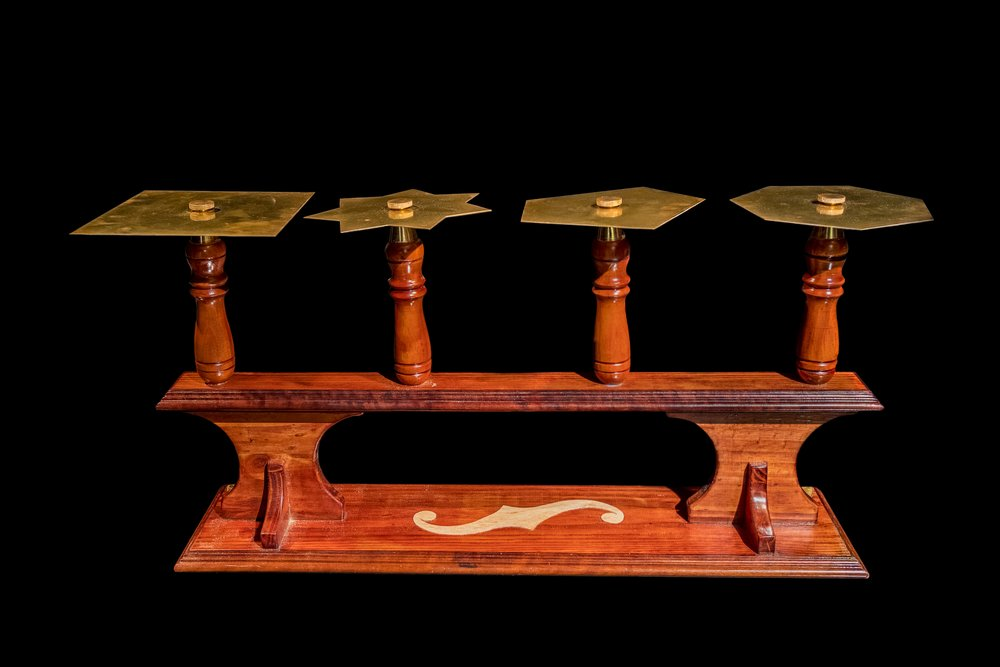
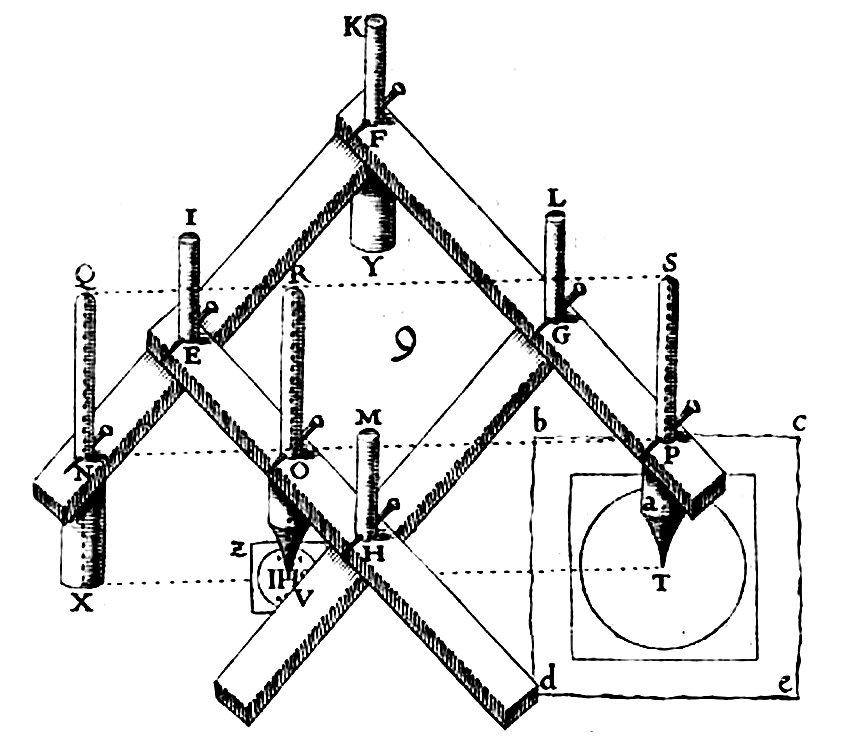
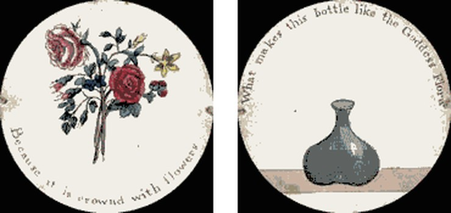

**A** [[ Chladnijeva plošča | Genaille–Lucasove palice | (Jevonsov logični klavir) | Llullov krog | Pantograf | Planimeter | Quipu | Taumatrop ]]

**B** [[ Chladnijeva plošča | Genaille–Lucasove palice | Jevonsov logični klavir | Llullov krog | Pantograf | Planimeter | (Quipu) | Taumatrop ]]

**C** [[ Chladnijeva plošča | Genaille–Lucasove palice | Jevonsov logični klavir | Llullov krog | Pantograf | (Planimeter) | Quipu | Taumatrop ]]

**D** [[ Chladnijeva plošča | Genaille–Lucasove palice | Jevonsov logični klavir | (Llullov krog) | Pantograf | Planimeter | Quipu | Taumatrop ]]

**E** [[ Chladnijeva plošča | (Genaille–Lucasove palice) | Jevonsov logični klavir | Llullov krog | Pantograf | Planimeter | Quipu | Taumatrop ]]

**F** [[ (Chladnijeva plošča) | Genaille–Lucasove palice | Jevonsov logični klavir | Llullov krog | Pantograf | Planimeter | Quipu | Taumatrop ]]

**G** [[ Chladnijeva plošča | Genaille–Lucasove palice | Jevonsov logični klavir | Llullov krog | (Pantograf) | Planimeter | Quipu | Taumatrop ]]

**H** [[ Chladnijeva plošča | Genaille–Lucasove palice | Jevonsov logični klavir | Llullov krog | Pantograf | Planimeter | Quipu | (Taumatrop) ]]

Vrstni red od najstarejšega do najnovejšega, vpišite črke (npr. A B C …):

[[B D G F H C A E]]
<script>
  "@input".toUpperCase().replace(/[^A-H]/g, "") == "BDGFHCAE"
</script>
*****************************************************************

| Črka | Učilo                          | Kaj uči                                  | Leto        |
| ---- | ------------------------------ | ---------------------------------------- | ----------- |
| B    | Quipu, vozlana vrvica Inkov     | zapis števil v desetiškem sistemu        | 15. stol.   |
| D    | Llullov krog (Ars magna)        | kombinatorika, kombiniranje pojmov       | okoli 1305  |
| G    | Pantograf                       | povečava risbe, podobnost, razmerja      | 1603        |
| F    | Chladnijeva plošča              | zvočno valovanje, stojno valovanje       | 1787        |
| H    | Taumatrop                       | zaznavanje slike, začetek animacije      | 1825        |
| C    | Polarni planimeter (Amsler)     | ploščina nepravilnega lika               | 1854        |
| A    | Jevonsov logični klavir         | logično sklepanje, Boolova logika        | 1869        |
| E    | Genaille–Lucasove palice        | množenje brez prenašanja                 | 1891        |

Chladnijeva plošča v živo:

!?[Chladnijeva plošča, 2 min](https://www.youtube.com/watch?v=tFAcYruShow)<!-- style="max-width:560px" -->

*****************************************************************

**Za pogovor:** katero od osmih bi danes uporabili pri svojem pouku in zakaj?


## Projekt MAKE&LEARN

_5 min_

Delavnica je del projekta Erasmus+. Kar naredite te tri dni, boste z dijaki ponovili v svoji šoli.

| 2                                      | 10                     | 20+                         | 15                 |
| -------------------------------------- | ---------------------- | --------------------------- | ------------------ |
| šoli                                   | učiteljev              | učil                        | mesecev            |
| ŠC Kranj, ETŠ Mija Stanimirović (Niš)  | 5 + 5                  | izdelajo dijaki z učitelji  | 9/2026 – 11/2027   |

| Kdaj                 | Kaj                              | Kje       |
| -------------------- | -------------------------------- | --------- |
| okt 2026             | **to usposabljanje**             | Kranj     |
| nov 2026 – jun 2027  | dijaki izdelajo učila            | obe šoli  |
| mar – jun 2027       | spletna knjižnica načrtov        | splet     |
| okt 2027             | predstavitev in tekmovanje       | Niš       |

**Dobro učilo** ima jasen pedagoški namen, deluje in je uporabno pri pouku. Po teh treh merilih bodo ocenjena tudi učila na tekmovanju.


## Zgodovina učil

_5 min_

Vsako učilo je nastalo, ker nekdo nečesa ni znal razložiti samo z besedami.


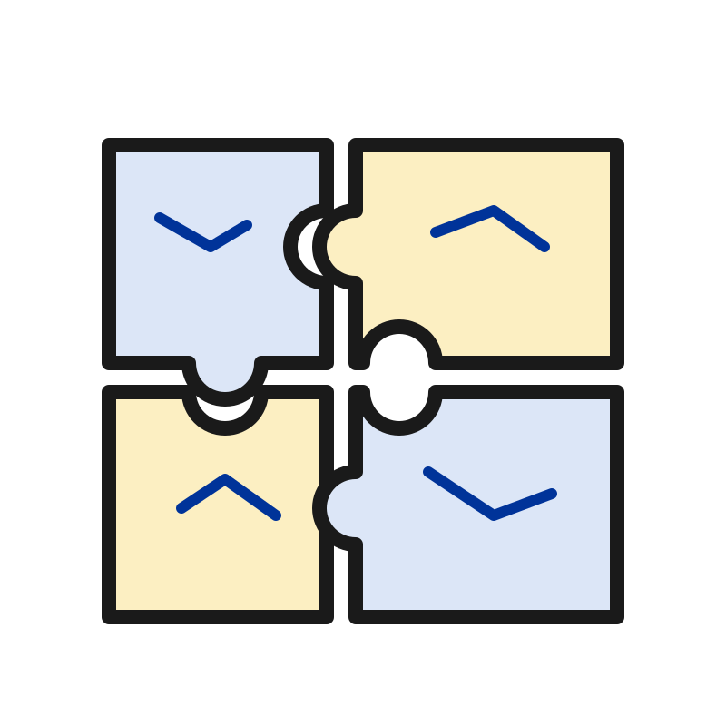
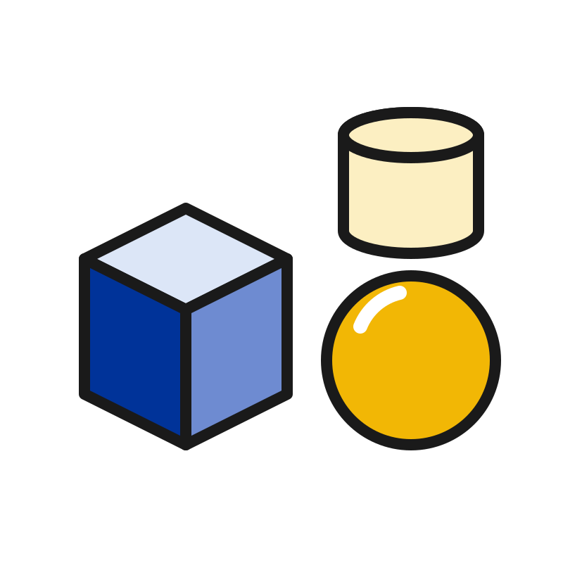
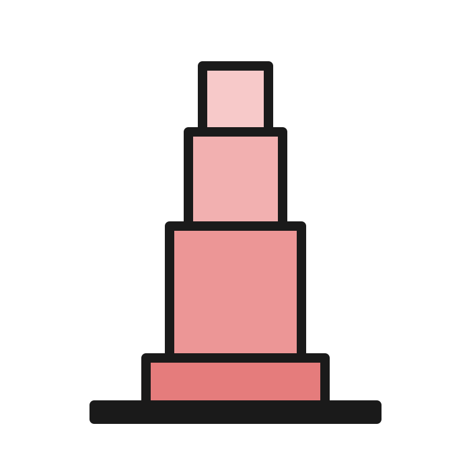
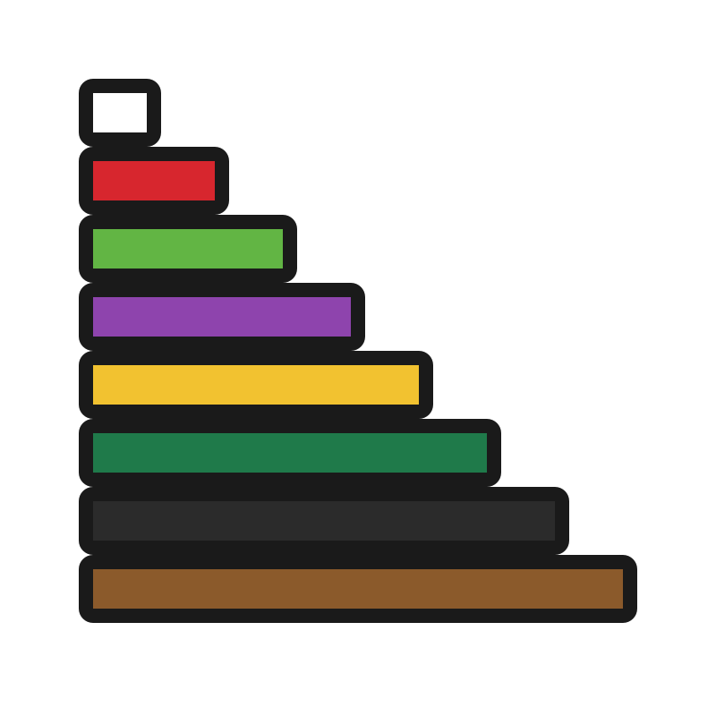
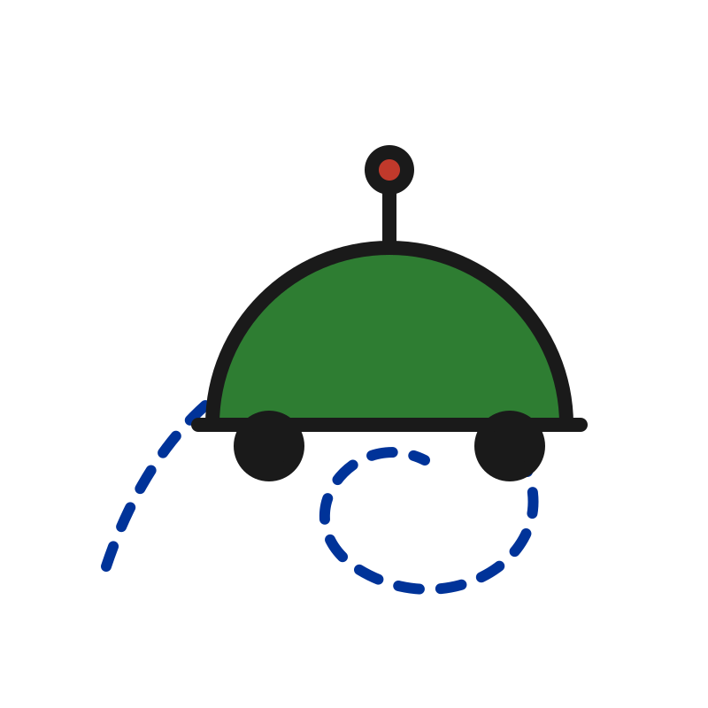
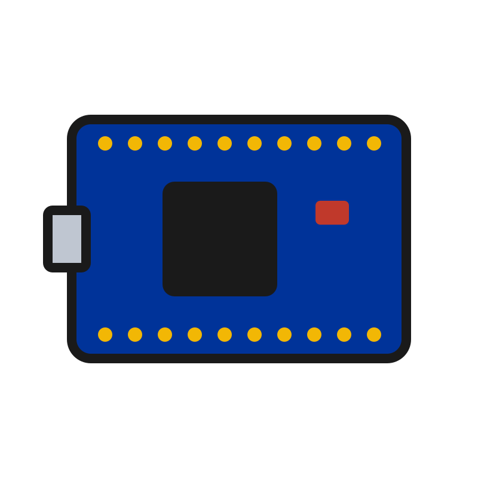


| Leto         | Učilo                    | Ideja                                          |
| ------------ | ------------------------ | ---------------------------------------------- |
| antika       | abak                     | računanje in mestne vrednosti                  |
| 15. stol.    | globus                   | Zemlja v roki                                  |
| okoli 1766   | zemljevid sestavljanka   | prva sestavljanka je bila zemljevid             |
| 1837         | Froeblovi darovi         | kocke, valji in krogle za prvi vrtec           |
| 1907         | Montessori pripomočki    | pripomoček sam pokaže napako                   |
| 1952         | Cuisenairjeve palčke     | števila kot dolžine                            |
| 1967         | Logo želva               | otroci programirajo robota, ki riše            |
| 2005         | mikrokrmilniki           | Arduino, kasneje micro:bit in ESP32            |
| 2022         | umetna inteligenca       | danes z njo sami naredimo spletno učilo        |


## Konkretno, slikovno, abstraktno

_10 min_

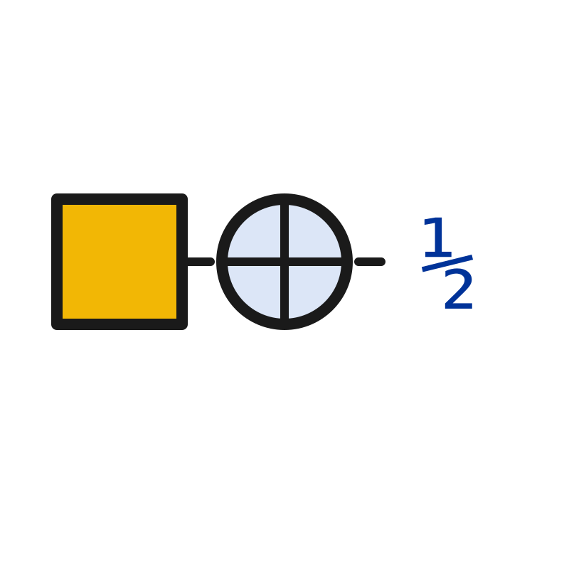<!-- style="float:right; width:150px; margin:0 0 1rem 1.5rem" -->

Psiholog Jerome Bruner je leta 1966 opisal tri stopnje učenja:

1. **konkretno:** z rokami,
2. **slikovno:** s sliko,
3. **abstraktno:** s simboli.

Šola pogosto začne kar pri simbolih. Dijak, ki zna formulo na pamet, a ne ve, kaj pomeni, je preskočil prvi dve stopnji.

!?[Concrete, pictorial, abstract, Oxford Education, 2 min, angleško](https://www.youtube.com/watch?v=VMpu9gVcT5g)<!-- style="max-width:560px" -->

| Predmet           | Konkretno: primem v roke                 | Slikovno: vidim                 | Abstraktno: zapišem   |
| ----------------- | ---------------------------------------- | ------------------------------- | --------------------- |
| matematika        | razrežem pico na pol                     | krog s pobarvano polovico       | ½                    |
| elektrotehnika    | baterija, žarnica in žice na mizi        | shema vezja                     | $U = R \cdot I$       |
| računalništvo     | obračam kartice z 1, 2, 4 in 8 pikami    | tabela mest 8 4 2 1             | $1011_2 = 11$         |
| kemija            | model molekule iz kroglic in paličic     | strukturna formula              | $\ce{H2O}$            |
| strojništvo       | zavrtim dva zobnika različnih velikosti  | risba zobniškega para           | $i = z_2 / z_1$       |
| zgodovina         | kartice z dogodki obešam na vrvico       | časovnica                       | letnice               |

Vsa učila iz igre zjutraj so konkretni korak do abstraktne ideje: quipu do desetiškega zapisa, Chladnijeva plošča do valovanja, planimeter do ploščine.

**Preverite se.** Na kateri stopnji je?

<!-- data-randomize -->
[[konkretno] [slikovno] [abstraktno]]
[    (X)        ( )         ( )     ] Dijak s peskom na plošči vidi, kako zveni kovina.
[    ( )        (X)         ( )     ] Graf hitrosti v odvisnosti od časa.
[    ( )        ( )         (X)     ] $P = U \cdot I$
[    (X)        ( )         ( )     ] Dijak z vozli na vrvici zapiše število 352.
[    ( )        (X)         ( )     ] Zemljevid Evrope.
[    ( )        ( )         (X)     ] $\ce{2H2 + O2 -> 2H2O}$

**V paru, 2 minuti:** poiščite eno temo, ki jo vaši dijaki spoznajo samo kot formulo ali definicijo. Zapišite jo na prvi listek. Z njo začnemo iskanje idej.


## Iskanje idej

_40 min · v paru · brez naglice_

**Rezultat:** nekaj idej za spletno aplikacijo in ena izbrana, opisana v treh stavkih.

Ne iščemo popolne ideje. Iščemo nekaj, kar bi radi preizkusili pri pouku.

<!-- style="float:right; width:140px; margin:0 0 1rem 1.5rem" -->

**1. Bolečine** · 10 min · vsak sam

- Na listke zapišite snov, ki je dijaki težko razumejo. Ena na listek.
- Prvi listek že imate s prejšnje prosojnice.

**2. Tema** · 5 min · v paru

- Listke preberita drug drugemu in izberita eno temo.
- Če želita, jo zapišita kot vprašanje: **Kako bi lahko …?**

**3. Mešalnik idej** · 15 min · v paru

- Pritisnite **Premešaj**. Dobite vrsto aplikacije in dodatek.
- Pogovorite se: kako bi naša tema delovala tako?
- Kar vam je všeč, zapišite. Kar ne, preskočite in premešajte znova.
- Dovolj so 3 do 5 idej.

<script input="button" input-always-active>
var vrste = ["kviz", "razvrščanje", "iskanje parov", "klik na sliko", "simulacija z drsniki", "časovnica"];
var dodatki = ["na čas", "slike namesto besed", "dijak najde napako", "od lažjega k težjemu", "za ves razred na tabli", "par proti paru"];
var v = vrste[Math.floor(Math.random() * vrste.length)];
var d = dodatki[Math.floor(Math.random() * dodatki.length)];
var card = "display:inline-block; padding:.7rem 1.2rem; margin:.3rem; border:1px solid #1f4fd1; border-radius:8px; font-size:1.35rem; background:#fff";
setTimeout(function () {
  var el = document.getElementById("mesalnik");
  if (el) {
    el.innerHTML = '<span style="' + card + '">' + v + '</span>'
      + '<span style="font-size:1.5rem; margin:0 .4rem; color:#5b6270">+</span>'
      + '<span style="' + card + '">' + d + '</span>';
  }
}, 50);
"Premešaj"
</script>

<div id="mesalnik" style="margin:.5rem 0 1.5rem; min-height:4rem"></div>

**4. Izbira** · 10 min · v paru

- Izberita idejo, ki bi jo najraje uporabila pri pouku. Iz nje bo aplikacija.
- Opišita jo v treh stavkih: **kaj je, kaj dijak počne, česa se nauči.**
- Ostale ideje shranite. Jutri lahko iz katere nastane fizično učilo.

**Primer: Ohmov zakon**

| Premešaj                                   | Ideja                                                     |
| ------------------------------------------ | --------------------------------------------------------- |
| simulacija z drsniki + na čas              | nastavi napetost, da žarnica zasveti v 10 sekundah        |
| razvrščanje + od lažjega k težjemu         | razvrsti vezja po toku, najprej tri, nato šest            |
| iskanje parov + slike namesto besed        | poveži shemo vezja s pravim tokom                         |
| kviz + dijak najde napako                  | v izračunu toka je napaka, poišči jo                      |
| **izbrana**                                | **simulacija z drsniki**                                  |

Brez računalnika gre tudi s kocko: na listu 2 sta obe tabeli.

[List 1: Iskanje idej (PDF)](https://github.com/Pfyber/LiaShow/blob/main/delovni-listi/01_iskanje_idej.pdf) · [List 2: Mešalnik idej (PDF)](https://github.com/Pfyber/LiaShow/blob/main/delovni-listi/02_mesalnik_idej.pdf)


## Odmor

_15 min · nadaljujemo ob 10.55_

Med odmorom preverite, da se lahko prijavite v GitHub in v AI. Po odmoru ju potrebujete.


## Spletna aplikacija

_35 min_

**Rezultat:** delujoča aplikacija za vašo idejo.

Iz izbrane ideje naredimo spletno učilo. Vsako od teh je ena sama datoteka, ki jo je napisala AI po kratkem opisu:


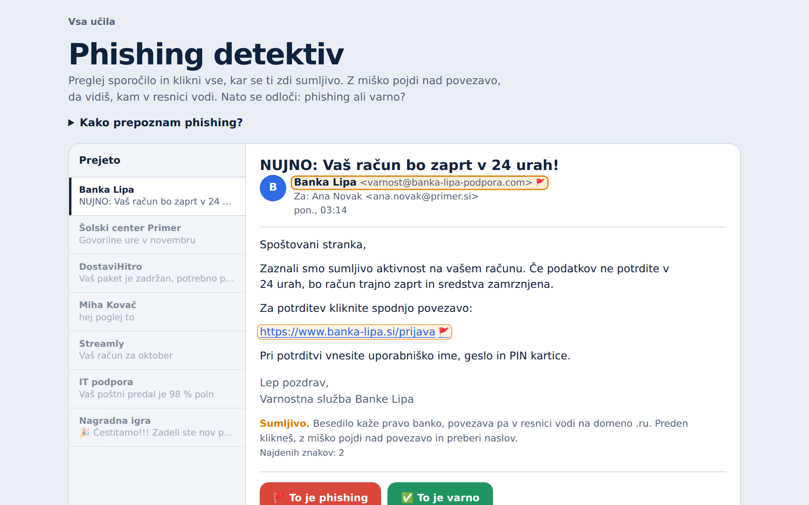
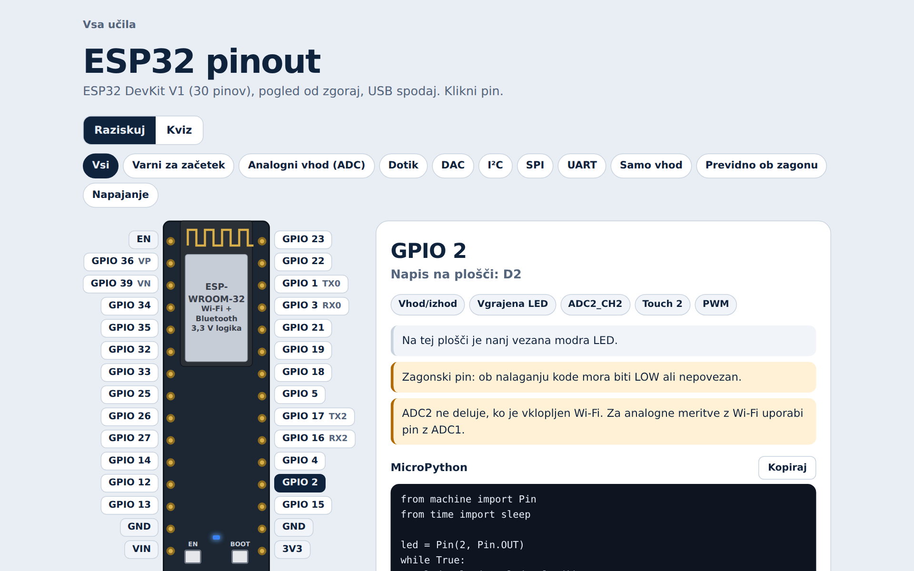
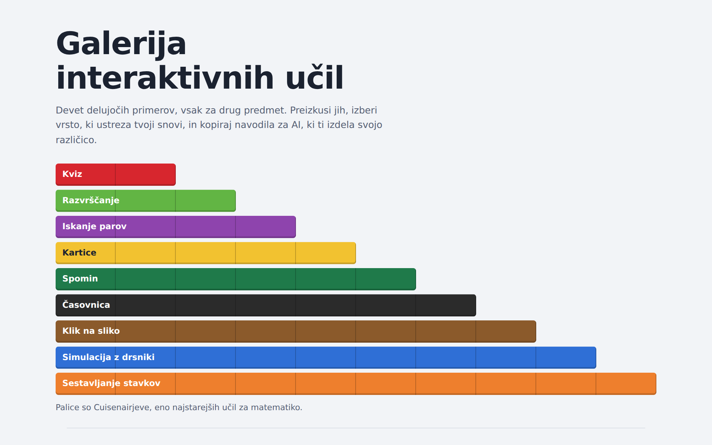
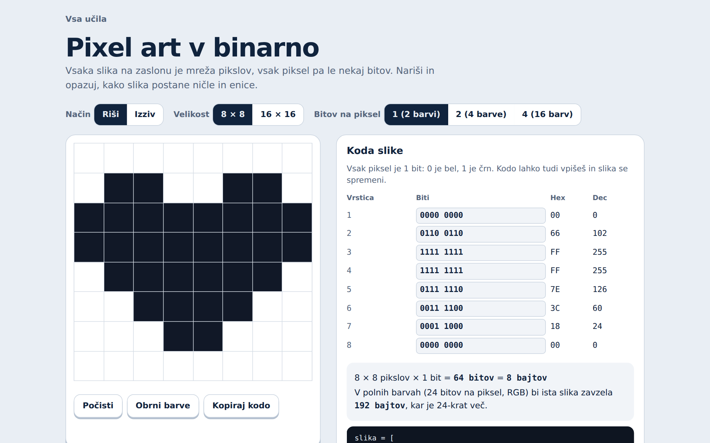
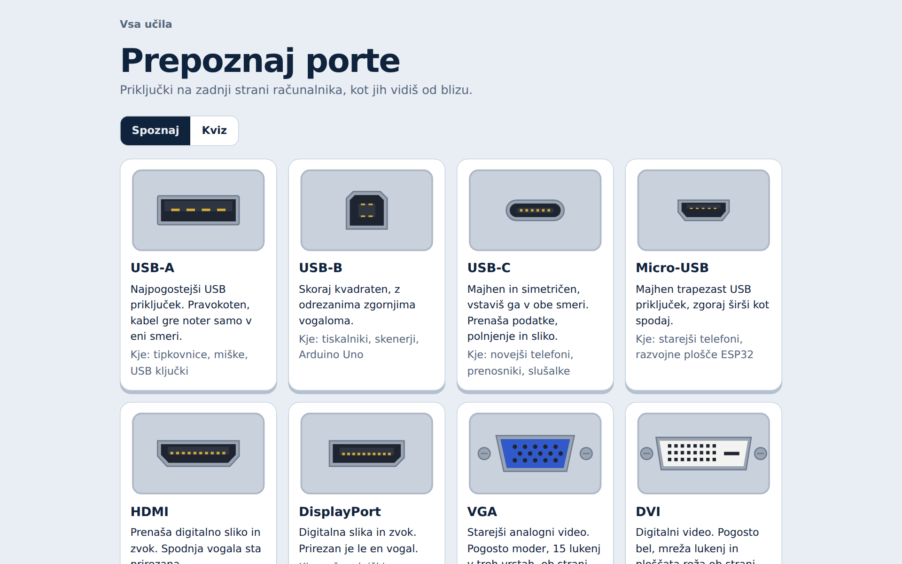

**Vrste:** kviz, razvrščanje, iskanje parov, kartice, spomin, časovnica, klik na sliko, simulacija, sestavljanje stavkov.

### List 3: opis učila

AI zna samo to, kar ji poveste. Bolj ko je opis konkreten, boljša je aplikacija. Najpomembnejša je točka 7: pravi seznam vprašanj ali pojmov, ne samo tema.

Kopirajte, izpolnite in pošljite AI.

``` text
Naredi spletno učilo po tem opisu.

1. Ideja v treh stavkih: [kaj je, kaj dijak počne, česa se nauči]
2. Naslov: [ ]
3. Predmet in letnik: [ ]
4. Učni cilj, po uporabi dijak zna: [ ]
5. Vrsta: [kviz / razvrščanje / pari / kartice / spomin / časovnica /
   klik na sliko / simulacija / sestavljanje stavkov]
6. Kaj dijak počne, korak za korakom: [ ]
7. Vsebina, moj seznam vprašanj ali pojmov: [ ]
8. Kaj vidi dijak, ko je pravilno in ko napačno: [ ]
9. Videz in jezik: [barve, veliki gumbi, slovensko ali srpsko]

Tehnična pravila:
- Ena sama datoteka index.html (HTML, CSS in JS v njej).
- Brez prijave, brez strežnika, brez zunanjih podatkov.
- Deluje na telefonu, računalniku in interaktivni tabli.
- Vsa vsebina v enem preglednem seznamu na vrhu kode.
- Preden napišeš kodo, mi postavi največ 3 vprašanja.

Ko je koda gotova, posebej napiši "Opis za učitelje" v treh stavkih:
kaj aplikacija dela, kako jo uporabim v razredu, kaj dijak pri tem vadi.
```

[List 3 za tisk (PDF)](https://github.com/Pfyber/LiaShow/blob/main/delovni-listi/03_opis_za_ai.pdf)

### Delo z AI

1. Odgovorite na vprašanja AI.
2. Preizkusite aplikacijo v predogledu AI. Če ga ni, kodo shranite kot `index.html` in jo odprite z dvoklikom.
3. Popravljajte eno stvar naenkrat: »Spremeni samo X, ostalo pusti.«
4. Pogovor pustite odprt. V naslednjem bloku kodo in opis objavimo.


## Objava na GitHub Pages

_25 min_

**Rezultat:** aplikacija na spletu, ki jo odpre vsak telefon.

- **GitHub** je brezplačen prostor za datoteke na spletu.
- **GitHub Pages** iz teh datotek naredi spletno stran.
- **Repozitorij** je mapa na spletu. Za učilo naredite enega.
- Vse delate v brskalniku, s kopiranjem in lepljenjem.

!?[GitHub Pages za začetnike, GitHub, 4 min, angleško](https://www.youtube.com/watch?v=b2r9Cdvssi0)<!-- style="max-width:560px" -->

1. **Repozitorij.** Na [github.com](https://github.com) kliknite **New**. Ime z malimi črkami, brez presledkov, npr. `ohmov-zakon`. Izberite **Public** in **Create repository**.
2. **Aplikacija.** Kliknite **creating a new file**. Ime `index.html`, prilepite kodo iz AI, **Commit changes**.
3. **Opis.** **Add file → Create new file**. Ime `opis.md`. Prilepite izpolnjen opis učila in Opis za učitelje iz AI. **Commit changes**. Tretji dan iz tega nastane stran učila.
4. **Objava.** **Settings → Pages**: Branch **main**, **/ (root)**, **Save**. Počakajte 1 do 2 minuti.

Vaša aplikacija je na naslovu `https://uporabnik.github.io/ohmov-zakon/` (namesto `uporabnik` vaše GitHub ime). Odprite jo na telefonu.

| Če …                    | Naredite                                                       |
| ----------------------- | -------------------------------------------------------------- |
| stran kaže 404          | počakajte še minuto; ime datoteke mora biti točno `index.html` |
| Pages ni na voljo       | repozitorij mora biti Public                                   |

[List 4: GitHub Pages za tisk (PDF)](https://github.com/Pfyber/LiaShow/blob/main/delovni-listi/04_github_pages.pdf)


## Interaktivni delovni zvezek

_25 min_

**Rezultat:** vaš učbenik ali delovni list kot interaktivni zvezek na spletu.

Aplikacija je novo učilo. Večino pouka pa še vedno nosijo učbeniki in delovni listi, ki so na papirju in ne odgovorijo.

**LiaScript** iz navadnega besedila naredi interaktivno gradivo:

- razlaga, slike in video,
- kvizi, ki se preverijo sami,
- brezplačno, v brskalniku, brez prijave.

Tudi ta tečaj je narejen tako.

<!-- style="max-width:560px" -->

!?[Hello LiaScript, 3 min, angleško](https://www.youtube.com/watch?v=rbqm6MN0We4)<!-- style="max-width:560px" -->

Tako je napisan kviz:

``` markdown
Koliko je tok pri 12 V in 4 Ω?

[( )] 2 A
[(X)] 3 A
[( )] 48 A
```

In tako deluje:

Koliko je tok pri 12 V in 4 Ω?

[( )] 2 A
[(X)] 3 A
[( )] 48 A

Oznak se ni treba učiti. Napiše jih AI, vi preverite vsebino. [Kaj vse zmore LiaScript](https://liascript.github.io/course/?https://raw.githubusercontent.com/Pfyber/LiaShow/main/liascript-zmore.md)

### Vaja: zvezek z AI

1. Izberite stran iz učbenika ali delovni list, ki ga že uporabljate. Tema je lahko ista kot pri aplikaciji ali druga.
2. Kopirajte poziv, prilepite svoje gradivo in pošljite AI.
3. Odgovor prilepite v [LiveEditor](https://liascript.github.io/LiveEditor/) in preizkusite vprašanja. Dejstva preverite, vsaj eno vprašanje popravite sami.
4. V repozitoriju: **Add file → Create new file**, ime `README.md`, prilepite zvezek, **Commit changes**.
5. Zvezek je na naslovu `https://liascript.github.io/course/?https://raw.githubusercontent.com/uporabnik/ohmov-zakon/main/README.md`

``` text
Si učitelj in avtor gradiv v LiaScriptu. Spodnje gradivo predelaj
v interaktivni delovni zvezek v LiaScriptu.

Predmet in letnik: [npr. Elektrotehnika, 2. letnik]
Gradivo: [prilepi besedilo iz učbenika ali delovnega lista]
Povezava do naše aplikacije: [https://uporabnik.github.io/ime/]

Zgradba:
1. Na vrhu komentar <!-- --> z vrsticami author, email, language: sl, comment.
2. "# Naslov" in uvod v treh stavkih.
3. "## Razlaga": bistvo gradiva v največ 10 kratkih stavkih in ena tabela.
4. "## Vaja": samo vrstica [Odpri aplikacijo](povezava zgoraj).
5. "## Vprašanja": 5 vprašanj. Uporabi oznake LiaScripta:
   en odgovor [( )] in [(X)], več odgovorov [[ ]] in [[X]],
   vpiši odgovor [[odgovor]], izbira [[ a | (b) | c ]].
   Pod vsako vprašanje dodaj namig v vrstici [[?]] in kratko razlago
   med dvema vrsticama zvezdic *****.
6. "## Za učitelja": namen, kako zvezek uporabim v razredu (čas, posamezno
   ali v paru) in česa se dijak nauči. Vsak del v dveh stavkih.

Uporabi samo dejstva iz gradiva. Piši preprosto, za dijake.
Vrni samo markdown, brez razlage.
```

| Če …                    | Naredite                                                       |
| ----------------------- | -------------------------------------------------------------- |
| zvezek kaže napako      | prilepite ga v LiveEditor in poglejte, kje se prikaz ustavi    |
| AI pokvari oznake       | »Popravi oznake LiaScripta, vsebine ne spreminjaj.«            |


## Zaključek dneva

_10 min_

- [x] ideja v treh stavkih in listek z ostalimi idejami
- [x] aplikacija na spletu
- [x] interaktivni delovni zvezek
- [x] `opis.md` v repozitoriju

1. **Povezavo do aplikacije pošljite vodji v Teams.**
2. Aplikacijo in zvezek odprite na partnerjevem telefonu. Delujeta?
3. Krog: ena stvar, ki vas je danes presenetila.

**Jutri:** v makerspaceu naredite fizično učilo. Preglejte listek z idejami: katera bi bila dobra v roki?


# 2. dan: izdelava

| Ura   | Blok                 |
| ----- | -------------------- |
| 9.00  | Včeraj               |
| 9.10  | Kaj je dobro učilo   |
| 9.25  | SCAMPER              |
| 9.55  | Varnost in 3D-tisk   |
| 10.35 | Odmor                |
| 10.50 | Laser in QR koda     |
| 11.30 | Prototip             |
| 12.15 | Pokaži in povej      |

**Danes:** fizično učilo iz makerspacea. Lahko je predmet za isto idejo kot aplikacija ali nova ideja z vašega listka. QR koda na učilu odpre aplikacijo ali zvezek.

**Fotografirajte vsak korak izdelave.** Jutri iz fotografij nastane stran učila.


## Včeraj

_10 min_

Vsak par v 30 sekundah pokaže aplikacijo na telefonu in pove, kaj je bilo najtežje.


## Kaj je dobro učilo

_15 min_

Pet lastnosti, ki jih imajo učila, ki se obdržijo. Vse smo včeraj videli v zgodovini.


|                                              | Lastnost                  | Primer                                           |
| -------------------------------------------- | ------------------------- | ------------------------------------------------ |
| <!-- style="height:60px" --> | 1. Samo pokaže napako     | Montessori: kos se ne prilega, če je narobe      |
| <!-- style="height:60px" --> | 2. En pojem               | Cuisenairjeve palčke: samo števila kot dolžine   |
| <!-- style="height:60px" --> | 3. Več čutil              | Chladnijeva plošča: zvok vidiš v pesku           |
| <!-- style="height:60px" --> | 4. Za vse dijake          | abak: deluje brez branja in brez jezika          |
|  | 5. Iz recikliranega       | karton, odpadni les, stara elektronika           |

Kaj od tega ima vaša ideja že zdaj?

[[1]] samo pokaže napako
[[2]] en pojem
[[3]] več čutil
[[4]] za vse dijake
[[5]] iz recikliranega

Česar nima, poskusite dodati v naslednjem bloku.


## SCAMPER

_30 min · na papirju_

**Rezultat:** ideja za fizično učilo.

<!-- style="float:right; width:150px; margin:0 0 1rem 1.5rem" -->

SCAMPER je sedem vprašanj, s katerimi obstoječo stvar spremenimo v novo. Najprej vadimo na nečem, kar že obstaja, potem uporabimo na svojem.

**Izhodišče izberete sami:**

- učilo, ki ga poznate ali uporabljate pri pouku,
- družabna igra: Človek ne jezi se, Spomin, Activity, Uno, Jenga, šah …,
- karkoli iz učilnice ali z zgodovinske prosojnice.

!?[SCAMPER, 2 min, angleško](https://www.youtube.com/watch?v=M2I4PSdt7_8)<!-- style="max-width:560px" -->

1. Izberita izhodišče in odgovorita na vseh sedem vprašanj, 10 minut.
2. Enako naredite za svojo idejo: izbrano idejo ali drugo idejo z mešalnika, 15 minut.
3. Odločite se, kakšno bo vaše fizično učilo, 5 minut.

| Črka | Pomen             | Vprašanje                                       |
| ---- | ----------------- | ----------------------------------------------- |
| S    | Zamenjaj          | Kaj lahko zamenjam: material, vsebino, obliko?  |
| C    | Združi            | S čim ga povežem: zvok, luč, QR koda?           |
| A    | Prilagodi         | Kako ga prilagodim svojemu predmetu?            |
| M    | Spremeni          | Večje, manjše, druge barve, več kosov?          |
| P    | Uporabi drugače   | Za kaj drugega bi ga uporabil?                  |
| E    | Odstrani          | Kaj izpustim, da ostane bistvo?                 |
| R    | Obrni             | Kaj, če naredim obratno?                        |

**Primer, Spomin:** pare slik zamenjaj s pari pojem in formula (S), na hrbtno stran dodaj QR kodo z razlago (C), velike kartice za ves razred na tabli (M).

**Primer, Človek ne jezi se:** na polja dodaj vprašanja iz snovi (A), namesto kocke kolo z enotami (S), kdor odgovori narobe, gre nazaj (R).

[List 5: SCAMPER (PDF)](https://github.com/Pfyber/LiaShow/blob/main/delovni-listi/05_scamper.pdf)


## Varnost

_5 min_

Preden se dotaknemo strojev:

1. Laser ne dela brez nadzora.
2. Odsesavanje je vedno vklopljeno.
3. Šoba 3D-tiskalnika je vroča, nad 200 °C.
4. Ob ognju: pokrov zaprt, stroj ustavi, pokliči.


## 3D-tisk

_35 min_

**Rezultat:** del učila v tiskalniku in datoteka STL.

<!-- style="float:right; width:150px; margin:0 0 1rem 1.5rem" -->

- 3D-tiskalnik po računalniškem modelu sloj za slojem zgradi predmet iz plastike.
- Tisk traja dolgo, zato morajo biti modeli do odmora v tiskalniku.

!?[Kako deluje 3D-tisk, 2 min, angleško](https://www.youtube.com/watch?v=Vx0Z6LplaMU)<!-- style="max-width:560px" -->

1. Najdite model na [Printables](https://www.printables.com) ali ga narišite v [Tinkercad](https://www.tinkercad.com).
2. Model naj se natisne v največ 20 minutah. Tisk zažene vodja.
3. STL shranite za stran učila.

**Ne veste, kaj bi tiskali?** Kocka za vaš predmet, na 6 ploskvah besede, simboli ali formule.

!?[Tinkercad za začetnike, 6 min, angleško](https://www.youtube.com/watch?v=lTeE7bIawPM)<!-- style="max-width:560px" -->


## Odmor

_15 min · nadaljujemo ob 10.50_


## Laser in QR koda

_40 min_

**Rezultat:** vgravirana QR koda, ki odpre vašo aplikacijo ali zvezek.

- Laserski rezalnik po risbi reže in gravira les, karton ali akril.
- QR koda poveže fizično učilo z digitalnim: dijak jo skenira s telefonom.

!?[Kako deluje laserski rez, 2 min, angleško](https://www.youtube.com/watch?v=SIjUVCho_xU)<!-- style="max-width:560px" -->

1. Odprite predlogo za laser v Inkscapu.
2. **Extensions → Render → Barcode → QR Code**.
3. Prilepite povezavo do aplikacije ali zvezka.
4. QR naj bo velik vsaj 25 mm.
5. Kodo preizkusite s telefonom na zaslonu, šele nato režite. SVG shranite za stran učila.

Rez gre po vrsti, 3 minute na par. Kdor čaka, že dela prototip.


## Prototip

_45 min · na papirju_

**Rezultat:** prototip, ki ga lahko primete, s QR kodo.

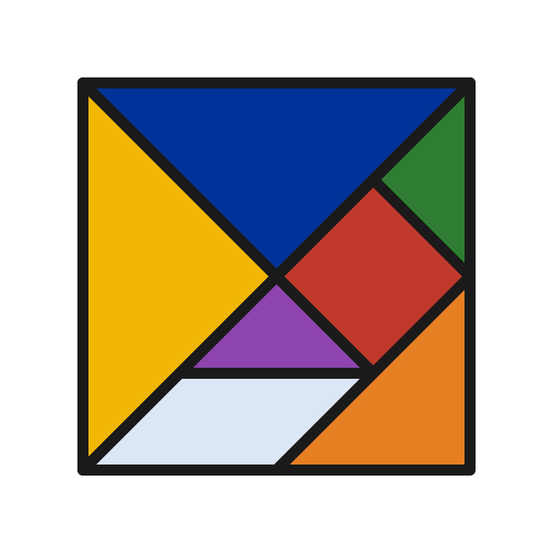<!-- style="float:right; width:150px; margin:0 0 1rem 1.5rem" -->

- Prototip ni končni izdelek. Pokaže, ali ideja deluje v roki.
- Najprej karton in odpadni material.
- Nato dodajte natisnjene in izrezane dele.

Na list 6 narišite skico in zapišite materiale. Jutri ju potrebujete za stran učila.

[List 6: Prototip (PDF)](https://github.com/Pfyber/LiaShow/blob/main/delovni-listi/06_prototip.pdf)


## Pokaži in povej

_15 min_

Vsak par 2 minuti: problem, učilo, QR koda. Ostali skenirajo in preizkusijo.

**Jutri:** prinesite fotografije, datoteki STL in SVG ter list 6.


# 3. dan: knjižnica in načrt

| Ura   | Blok                         |
| ----- | ---------------------------- |
| 9.00  | Včeraj                       |
| 9.10  | Kritični prijatelj           |
| 9.30  | Spletna knjižnica učil       |
| 9.45  | Priprava gradiva             |
| 10.05 | Pisanje strani               |
| 10.40 | Odmor                        |
| 10.55 | Akcijski načrt               |
| 11.45 | Oddaja                       |
| 12.00 | Predstavitve                 |
| 12.20 | Zaključek                    |

**Danes:** iz vsega, kar imate, nastane stran učila. Vsak napiše še načrt, kako bo učilo izdelal z dijaki.


## Včeraj

_10 min_

Prevzemite natisnjene dele in jih dodajte prototipu. Fotografirajte končan prototip.


## Kritični prijatelj

_20 min · na papirju_

**Rezultat:** povratna informacija drugega para in ena izboljšava.

Dva para se združita. Kdor učila ni delal, vidi, česar avtor ne vidi več.

1. Par predstavi učilo, 3 minute. Drugi par ga preizkusi.
2. Drugi par napiše po en stavek v vsako polje: **Všeč mi je … · Želim si … · Kaj če …?**
3. Zamenjajta vlogi.
4. Vsak par se odloči, kaj bo spremenil.

[List 7: Kritični prijatelj (PDF)](https://github.com/Pfyber/LiaShow/blob/main/delovni-listi/07_kriticni_prijatelj.pdf)


## Spletna knjižnica učil

_15 min_

Učila iz projekta bodo zbrana v javni spletni knjižnici, v slovenščini, srbščini in angleščini. Vsako dobi svojo stran z enakimi razdelki, da ga lahko ponovi vsak učitelj.

<!-- style="max-width:640px" -->

- Na vrhu so podatki: predmet, letnik, šola, avtorji, materiali, orodja.
- Spodaj so razdelki, vedno v istem vrstnem redu.
- Datoteke za izdelavo (STL, SVG) se na strani pokažejo same, kot seznam za prenos.
- Vrstica o sofinanciranju Erasmus+ je na vsaki strani samodejno, sami je ne pišete.

| Razdelek                    | Vsebina                                         |
| --------------------------- | ----------------------------------------------- |
| Namen                       | kateri problem rešuje, kaj dijak zna po uporabi |
| Materiali in orodja         | kaj potrebujete, kaj je reciklirano             |
| Izdelava                    | koraki s fotografijami                          |
| Uporaba pri pouku           | kako ga uporabite v uri                         |
| Kako so sodelovali dijaki   | kaj so načrtovali, izdelali in preizkusili      |
| Nadgradnje                  | ideje za naprej                                 |

Stran je napisana v markdownu, enako kot vaš zvezek. Napiše jo AI iz vaših zapiskov, v slovenščini, srbščini in angleščini.


## Priprava gradiva

_20 min_

**Rezultat:** mapa z vsem, kar stran potrebuje.

Na računalniku naredite mapo `priimek-ucilo` in vanjo zložite:

```
priimek-ucilo/
   index.sl.md      (nastanejo v naslednjem bloku)
   index.sr.md
   index.en.md
   slike/
      naslovna.jpg
      korak-1.jpg
      korak-2.jpg
   datoteke/
      model.stl
      rezanje.svg
```

1. Izberite eno naslovno fotografijo in eno za vsak korak izdelave.
2. Preimenujte jih: `naslovna.jpg`, `korak-1.jpg`, `korak-2.jpg` …
3. Dodajte STL in SVG.
4. V svojem repozitoriju odprite `opis.md` in ga kopirajte. Potrebovali ga boste v naslednjem bloku.


## Pisanje strani

_35 min_

**Rezultat:** stran v treh jezikih: `index.sl.md`, `index.sr.md`, `index.en.md`.

Stran napiše AI iz vaših podatkov. Vaša naloga je preveriti, ali je vse res.

1. Kopirajte prvi poziv. Prilepite `opis.md` in razdelek Za učitelja iz zvezka. Dopolnite seznam DOPOLNI.
2. Pošljite AI. Preberite rezultat: kar ni res, zbrišite; dopolnite mesta `[manjka]`.
3. Rezultat shranite kot `index.sl.md` v mapo `priimek-ucilo`.
4. Z drugim pozivom ga AI prevede v srbščino in angleščino. Shranite `index.sr.md` in `index.en.md`.
5. Partner iz Niša prebere srbski prevod in popravi, kar ne zveni prav.

**Poziv 1: stran v slovenščini**

``` text
Izpolni predlogo strani učila s spodnjimi podatki.
Stran opisuje fizično učilo. Aplikacijo in zvezek omeni pri Uporabi pri pouku.
Uporabi samo te podatke, ne izmišljuj. Kjer podatka ni, napiši [manjka].
Kratki stavki, preprost jezik, slovensko.
Pri Izdelavi oštevilči korake in pod vsakega dodaj .
Vrni samo izpolnjeno predlogo, brez razlage.

OPIS UČILA (opis.md):
[prilepi]

ZA UČITELJA (iz delovnega zvezka):
[prilepi]

DOPOLNI:
- Avtorja in šola: [ ]
- En stavek za kartico v knjižnici: [kaj je in česa se dijak nauči]
- Čas izdelave: [npr. 4 šolske ure]
- Zahtevnost: [lahko / srednje / zahtevno]
- Materiali, označi reciklirane: [ ]
- Orodja: [laser, 3D-tisk, karton …]
- Koraki izdelave: [1. … 2. … 3. …]
- Kako bodo sodelovali dijaki: [ ]
- Kaj bomo spremenili po kritičnem prijatelju: [ ]
- Povezava do aplikacije: [ ]
- Povezava do zvezka: [ ]

PREDLOGA:
---
title: ""
opis: ""
avtorji: []
sola: ""
predmet: ""
letnik: ""
cas_izdelave: ""
tezavnost: ""
materiali: []
reciklirano: true
orodja: []
naslovna: "slike/naslovna.jpg"
aplikacija: ""
zvezek: ""
licenca: "CC BY-SA 4.0"
---

## Namen
## Materiali in orodja
## Izdelava
## Uporaba pri pouku
## Kako so sodelovali dijaki
## Nadgradnje
```

**Poziv 2: prevod v srbščino in angleščino**

``` text
Prevedi spodnjo stran učila v srbščino (latinica, ekavica) in v angleščino.
Vrni dve ločeni datoteki: najprej index.sr.md, nato index.en.md.

Pravila:
- Oznak na vrhu (title:, opis:, predmet: …) ne prevajaj, prevedi samo vrednosti.
- Poti do slik (slike/...), povezave ter imena oseb in šol pusti enake.
- Naslove razdelkov prevedi tako:
  srbsko: Svrha, Materijali i alati, Izrada, Upotreba u nastavi,
          Kako su učestvovali učenici, Nadogradnje
  angleško: Purpose, Materials and tools, How to make it, Use in class,
            How students took part, Ideas for later
- Ničesar ne dodajaj.

[prilepi index.sl.md]
```

Raje najprej na papir? [List 8: Stran učila (PDF)](https://github.com/Pfyber/LiaShow/blob/main/delovni-listi/08_stran_ucila.pdf)


## Odmor

_15 min · nadaljujemo ob 10.55_


## Akcijski načrt

_50 min · vsak učitelj svojega · na papirju_

**Rezultat:** vaš načrt, kako boste do junija 2027 učilo izdelali z dijaki. To je obvezen rezultat projekta.

Do zdaj ste učilo naredili vi. V projektu ga naredijo dijaki. Načrt pove, kdaj, s kom in kako.

Prvih 15 minut dokončajte stran, nato pišite načrt.

1. Predmet, letnik, število dijakov in ekip.
2. Katero učilo bodo izdelali dijaki in kaj se pri tem naučijo.
3. Kaj delate vsak mesec od novembra do junija.
4. Materiali, najprej reciklirani.
5. Kdaj ga preizkusite v razredu.
6. Kako boste dijake vprašali po motivaciji.

| Mesec    | Primer vrstice                                          |
| -------- | ------------------------------------------------------- |
| november | predstavim projekt, dijaki v ekipah iščejo bolečine     |
| december | mešalnik idej in izbira ideje, prvi prototip iz kartona |

List oddate vodji.

[List 9: Akcijski načrt (PDF)](https://github.com/Pfyber/LiaShow/blob/main/delovni-listi/09_akcijski_nacrt.pdf)


## Oddaja

_15 min_

V skupno mapo v Teamsu naložite mapo `priimek-ucilo`:

```
priimek-ucilo/
   index.sl.md
   index.sr.md
   index.en.md
   slike/
   datoteke/
```

- [ ] `index.sl.md`, `index.sr.md` in `index.en.md`, brez oznak `[manjka]`
- [ ] srbski prevod je prebral partner iz Niša
- [ ] izpolnjeni `opis`, `aplikacija` in `zvezek` na vrhu strani
- [ ] naslovna fotografija in fotografije korakov
- [ ] STL in SVG
- [ ] akcijski načrt oddan

[List 10: Oddaja (PDF)](https://github.com/Pfyber/LiaShow/blob/main/delovni-listi/10_markdown_oddaja.pdf)


## Predstavitve

_20 min_

Vsak par 3 minute: problem, učilo v roki, kako ga bodo izdelali dijaki. Nato eno vprašanje iz publike.


## Zaključek

_10 min_

| Kdaj      | Kaj                               |
| --------- | --------------------------------- |
| nov 2026  | začetek z dijaki                  |
| jun 2027  | 10 učil na šolo                   |
| okt 2027  | predstavitev in tekmovanje v Nišu |

Repozitorij ostane vaš. Z enakimi pozivi naredite zvezek in aplikacijo za katero koli temo.

1. **Vprašalnik** izpolnite na papirju, anonimno, in ga oddajte vodji.
2. Skupinska fotografija.

[List 12: Vprašalnik (PDF)](https://github.com/Pfyber/LiaShow/blob/main/delovni-listi/12_vprasalnik.pdf)


# Priloge


## Pozivi za AI

| Poziv           | Kdaj       | Kaj vstavite                         | Kaj dobite                        |
| --------------- | ---------- | ------------------------------------ | --------------------------------- |
| Aplikacija      | 1. dan     | ideja in opis učila (list 3)         | `index.html` in Opis za učitelje  |
| Delovni zvezek  | 1. dan     | stran iz učbenika ali delovni list   | `README.md` z razdelkom Za učitelja |
| Stran učila     | 3. dan     | `opis.md`, Za učitelja, nove podatke | `index.sl.md` za knjižnico        |
| Prevod strani   | 3. dan     | `index.sl.md`                        | `index.sr.md` in `index.en.md`    |

**Pravila za delo z AI:** konkreten opis, ena sprememba naenkrat, dejstva preverite sami, kar ni res, zbrišite.


## 20 klasičnih učil za navdih

| 1 | 7 | 14 | 16 | 17 | 20 |
| - | - | -- | -- | -- | -- |
| 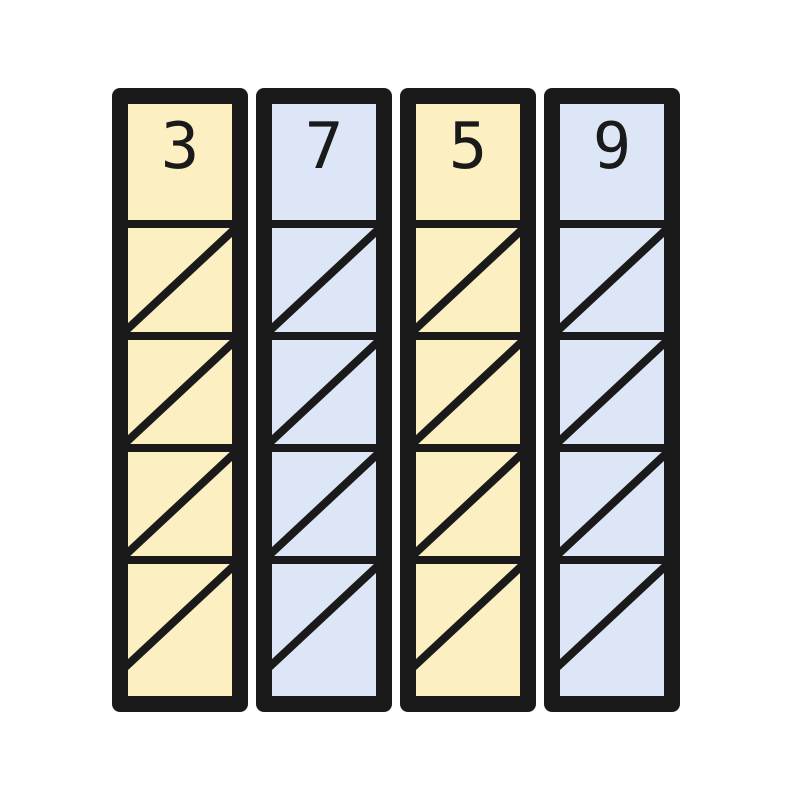<!-- style="height:70px" --> | <!-- style="height:70px" --> | 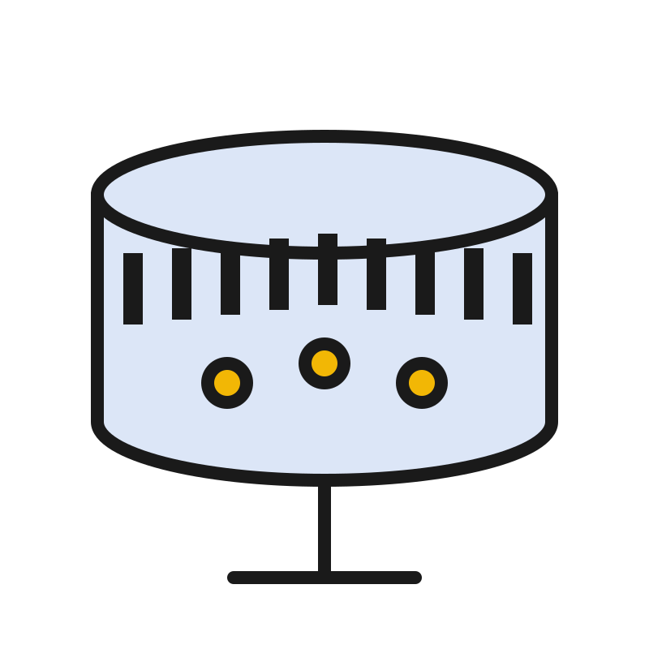<!-- style="height:70px" --> | 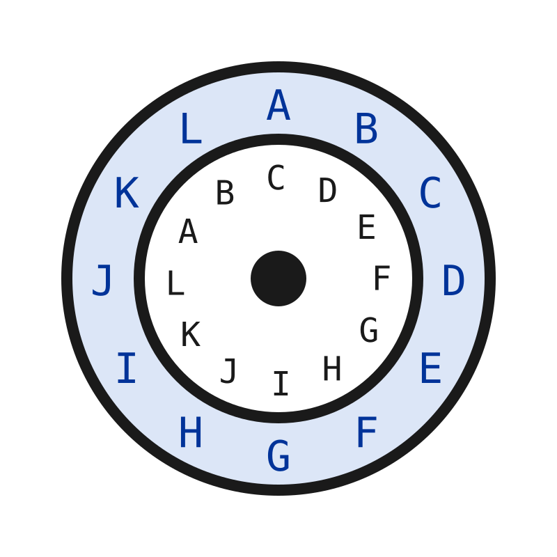<!-- style="height:70px" --> | 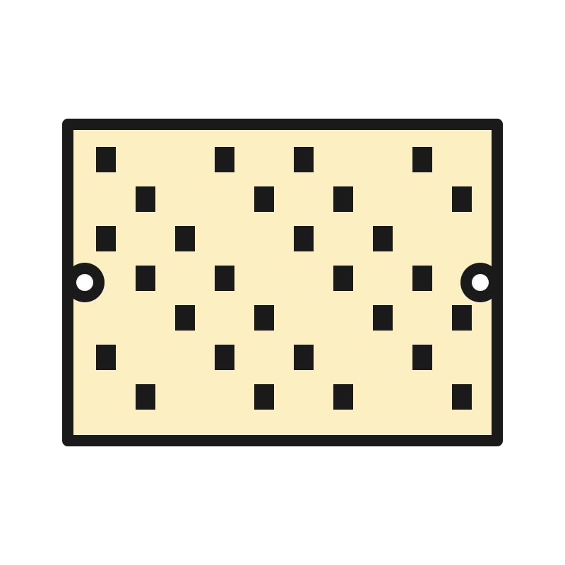<!-- style="height:70px" --> | 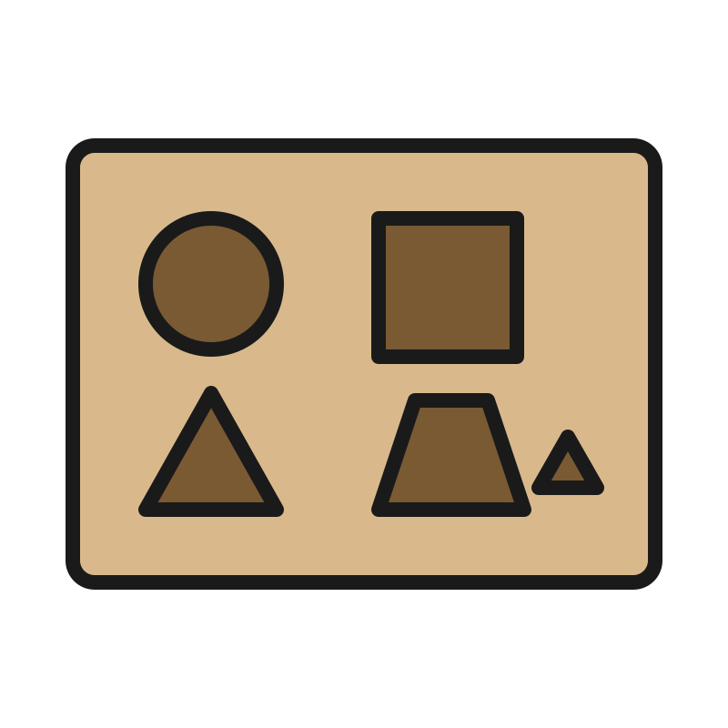<!-- style="height:70px" --> |

| #  | Učilo                          | Leto       | Kaj uči                      | Izdelava          |
| -- | ------------------------------ | ---------- | ---------------------------- | ----------------- |
| 1  | Napierjeve palice              | 1617       | množenje                     | laser             |
| 2  | logaritemsko računalo          | ok. 1630   | logaritmi                    | laser             |
| 3  | geoplošča                      | 1950-a     | liki, ploščina, koti         | laser, zatiči     |
| 4  | Dienesove kocke                | 1960-a     | mestne vrednosti, dvojiško   | 3D-tisk           |
| 5  | Montessori zlate perle         | zač. 1900  | enice, desetice, stotice     | perle, žica       |
| 6  | Soma kocka                     | 1933       | prostorska predstava         | les, 3D-tisk      |
| 7  | Hanojski stolp                 | 1883       | rekurzija, algoritmi         | laser, palice     |
| 8  | Keplerjeva telesa              | 1596       | geometrijska telesa          | laser, 3D-tisk    |
| 9  | astrolab                       | antika     | zvezde, čas, koti            | laser             |
| 10 | planetarij (orrery)            | ok. 1704   | gibanje planetov             | 3D-tisk, zobniki  |
| 11 | mehanski števec                | 1642       | prenos pri seštevanju        | 3D-tisk           |
| 12 | camera obscura                 | antika     | optika, oko                  | karton, leča      |
| 13 | stereoskop                     | 1838       | 3D vid                       | laser, leči       |
| 14 | zoetrop                        | 1834       | animacija                    | karton, laser     |
| 15 | laterna magika                 | 17. stol.  | projekcija                   | škatla, LED       |
| 16 | Albertijev disk                | 1467       | šifriranje                   | laser             |
| 17 | Jacquardove luknjane kartice   | 1804       | programiranje                | laser             |
| 18 | Morsejev telegraf              | 1830-a     | kodiranje signalov           | les, ESP32        |
| 19 | Vesalijeva anatomija           | 1543       | plasti telesa                | laser, papir      |
| 20 | Séguinova deska                | 1840-a     | oblike, vključevanje         | laser             |

[List 11 za tisk (PDF)](https://github.com/Pfyber/LiaShow/blob/main/delovni-listi/11_20_klasicnih_ucil.pdf)


## Delovni listi

| List | Kdaj    | PDF                                                                                                       |
| ---- | ------- | --------------------------------------------------------------------------------------------------------- |
| 1    | 1. dan  | [Iskanje idej](https://github.com/Pfyber/LiaShow/blob/main/delovni-listi/01_iskanje_idej.pdf)             |
| 2    | 1. dan  | [Mešalnik idej](https://github.com/Pfyber/LiaShow/blob/main/delovni-listi/02_mesalnik_idej.pdf)           |
| 3    | 1. dan  | [Opis za AI](https://github.com/Pfyber/LiaShow/blob/main/delovni-listi/03_opis_za_ai.pdf)                 |
| 4    | 1. dan  | [GitHub Pages](https://github.com/Pfyber/LiaShow/blob/main/delovni-listi/04_github_pages.pdf)             |
| 5    | 2. dan  | [SCAMPER](https://github.com/Pfyber/LiaShow/blob/main/delovni-listi/05_scamper.pdf)                       |
| 6    | 2. dan  | [Prototip](https://github.com/Pfyber/LiaShow/blob/main/delovni-listi/06_prototip.pdf)                     |
| 7    | 3. dan  | [Kritični prijatelj](https://github.com/Pfyber/LiaShow/blob/main/delovni-listi/07_kriticni_prijatelj.pdf) |
| 8    | 3. dan  | [Stran učila](https://github.com/Pfyber/LiaShow/blob/main/delovni-listi/08_stran_ucila.pdf)               |
| 9    | 3. dan  | [Akcijski načrt](https://github.com/Pfyber/LiaShow/blob/main/delovni-listi/09_akcijski_nacrt.pdf)         |
| 10   | 3. dan  | [Markdown in oddaja](https://github.com/Pfyber/LiaShow/blob/main/delovni-listi/10_markdown_oddaja.pdf)    |
| 11   | priloga | [20 klasičnih učil](https://github.com/Pfyber/LiaShow/blob/main/delovni-listi/11_20_klasicnih_ucil.pdf)   |
| 12   | 3. dan  | [Vprašalnik](https://github.com/Pfyber/LiaShow/blob/main/delovni-listi/12_vprasalnik.pdf)                 |

[Vsi listi v enem PDF](https://github.com/Pfyber/LiaShow/blob/main/delovni-listi/00_vsi_delovni_listi.pdf)


## O tečaju

Erasmus+ KA210-VET MAKE&LEARN · ŠC Kranj · ETŠ Mija Stanimirović
Sofinancira Evropska unija.

Ta tečaj je odprt (CC BY-SA 4.0). Lahko ga kopirate, prevedete in prilagodite.

**Fotografije pri igri Ugani učilo** (Wikimedia Commons)

- A: Nelson, en.wikipedia, [CC BY-SA 2.0](https://commons.wikimedia.org/wiki/File:William_Stanley_Jevons_Logic_Piano.jpg)
- B: Claus Ableiter, [CC BY-SA 3.0](https://commons.wikimedia.org/wiki/File:Inca_Quipu.jpg)
- C: CIA, [javna last](https://commons.wikimedia.org/wiki/File:Compensating_Polar_Planimeter_%2830880918835%29.jpg)
- D: Ramon Llull, Ars magna, [javna last](https://commons.wikimedia.org/wiki/File:Ramon_Llull_-_Ars_Magna_Fig_1.png)
- E: Worrydream, [javna last](https://commons.wikimedia.org/wiki/File:Genaille-Lucas_rulers_full_600.png)
- F: Rodrigo Tetsuo Argenton, eksponat Estes Objethos Atelier, [CC BY-SA 4.0](https://commons.wikimedia.org/wiki/File:Chladni_plate_01.jpg)
- G: Christoph Scheiner, [javna last](https://commons.wikimedia.org/wiki/File:Pantograph_by_Christoph_Scheiner_%28crop%29.png)
- H: taumatrop iz leta 1825, obe strani, [javna last](https://commons.wikimedia.org/wiki/File:Taumatropio_fiori_e_vaso,_1825_Frame_1.png)
