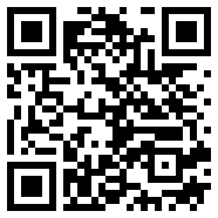
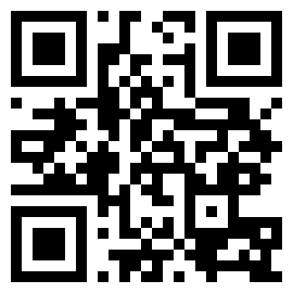
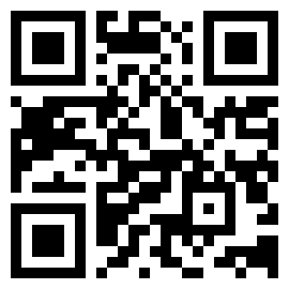
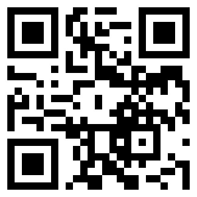
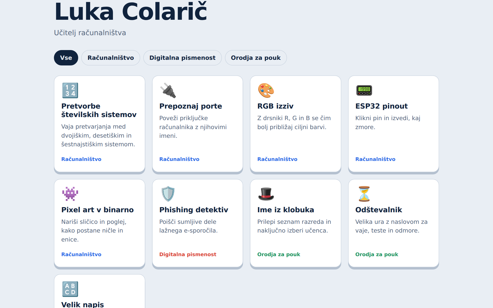

<!--
author:   Luka Colarič
email:    luka.colaric@sckr.si
version:  1.0.0
comment:  MAKE&LEARN. Usposabljanje učiteljev / obuka nastavnika, 28.–30. 10. 2026, ŠC Kranj, MladLab.
          Ta tečaj je hkrati primer: vse, kar vidite, je en sam markdown v LiaScriptu.
logo:     img/art_tangram.png
tags:     MAKE&LEARN, Erasmus+, učila, LiaScript
-->

# Od ideje do učila

_Od ideje do nastavnog sredstva_

**MAKE&LEARN** · usposabljanje učiteljev / obuka nastavnika
28.–30. 10. 2026 · ŠC Kranj, MladLab

Ta tečaj je napisan v LiaScriptu: en sam markdown na GitHubu, ki ga brskalnik prikaže kot tečaj s kvizi in delovnimi listi. Prvi dan boste enako naredili tudi vi.

_Ovaj kurs je napisan u LiaScriptu. Prvog dana ćete i vi napraviti isto._

<!-- style="width:120px" -->
<!-- style="width:120px" -->


## Tri dni, ena ideja

_Tri dana, jedna ideja_

| Dan | Kaj naredimo                                                    | Kaj odnesete                         |
| --- | --------------------------------------------------------------- | ------------------------------------ |
| 1   | Iskanje idej, delovni zvezek LiaScript, spletna aplikacija z AI  | aplikacija na GitHub Pages           |
| 2   | SCAMPER, 3D-tisk, laser, karton                                  | prototip z QR kodo do aplikacije     |
| 3   | Kritični prijatelj, markdown, stran za knjižnico                 | stran učila in akcijski načrt        |

Delate v paru: en učitelj iz Kranja, eden iz Niša. Isti par vse tri dni.

_Radite u paru: jedan nastavnik iz Kranja, jedan iz Niša._


## Projekt MAKE&LEARN

_Erasmus+ KA210-VET, partnerstvo manjšega obsega_

| 2                                      | 10                     | 20+                         | 15                 |
| -------------------------------------- | ---------------------- | --------------------------- | ------------------ |
| šoli · škole                           | učiteljev · nastavnika | učil · sredstava            | mesecev · meseci   |
| ŠC Kranj, ETŠ Mija Stanimirović (Niš)  | 5 + 5                  | izdelajo dijaki z učitelji  | 9/2026 – 11/2027   |

Dijaki in učitelji skupaj izdelajo učila za redni pouk, čim več iz recikliranih materialov, s 3D-tiskom ali CNC, kjer ima to smisel.

_Učenici i nastavnici zajedno prave nastavna sredstva za redovnu nastavu._


## Kaj se zgodi v projektu

_Šta se dešava u projektu_

| Kdaj                 | Kaj                              | Kje       |
| -------------------- | -------------------------------- | --------- |
| okt 2026             | **to usposabljanje**             | Kranj     |
| nov 2026 – jun 2027  | dijaki izdelajo učila            | obe šoli  |
| mar – jun 2027       | spletna knjižnica načrtov        | splet     |
| okt 2027             | predstavitev in tekmovanje       | Niš       |

**Merila dobrega učila:** jasen pedagoški namen, deluje, uporabno pri pouku.

_Kriterijumi: jasna svrha, funkcioniše, upotrebljivo u nastavi._


# 1. dan: od ideje do aplikacije

_1. dan: od ideje do aplikacije_

| Ura   | Blok                              | List |
| ----- | --------------------------------- | ---- |
| 9.00  | Ugani učilo                       |      |
| 9.15  | Spoznavanje in pari               |      |
| 9.30  | Projekt in zgodovina učil         |      |
| 10.00 | Iskanje idej                      | 1, 2 |
| 10.40 | Odmor                             |      |
| 10.55 | Delovni zvezek LiaScript          |      |
| 11.20 | Spletna aplikacija z AI           | 3    |
| 11.55 | Objava na GitHub Pages            | 4    |
| 12.20 | Zaključek                         |      |


## Ugani učilo

_Pogodi sredstvo · 15 min · v paru_

Osem resničnih učil in pripomočkov iz zgodovine. Za vsako izberi ime, nato vsa razvrsti od najstarejšega do najnovejšega.


**A** [[ Chladnijeva plošča | Genaille–Lucasove palice | (Jevonsov logični klavir) | Llullov krog | Pantograf | Planimeter | Quipu | Taumatrop ]]

**B** [[ Chladnijeva plošča | Genaille–Lucasove palice | Jevonsov logični klavir | Llullov krog | Pantograf | Planimeter | (Quipu) | Taumatrop ]]

**C** [[ Chladnijeva plošča | Genaille–Lucasove palice | Jevonsov logični klavir | Llullov krog | Pantograf | (Planimeter) | Quipu | Taumatrop ]]

**D** [[ Chladnijeva plošča | Genaille–Lucasove palice | Jevonsov logični klavir | (Llullov krog) | Pantograf | Planimeter | Quipu | Taumatrop ]]

**E** [[ Chladnijeva plošča | (Genaille–Lucasove palice) | Jevonsov logični klavir | Llullov krog | Pantograf | Planimeter | Quipu | Taumatrop ]]

**F** [[ (Chladnijeva plošča) | Genaille–Lucasove palice | Jevonsov logični klavir | Llullov krog | Pantograf | Planimeter | Quipu | Taumatrop ]]

**G** [[ Chladnijeva plošča | Genaille–Lucasove palice | Jevonsov logični klavir | Llullov krog | (Pantograf) | Planimeter | Quipu | Taumatrop ]]

**H** [[ Chladnijeva plošča | Genaille–Lucasove palice | Jevonsov logični klavir | Llullov krog | Pantograf | Planimeter | Quipu | (Taumatrop) ]]

Vrstni red od najstarejšega do najnovejšega, vpiši črke (npr. A B C …):

[[B D G F H C A E]]
<script>
  "@input".toUpperCase().replace(/[^A-H]/g, "") == "BDGFHCAE"
</script>
*****************************************************************

| Črka | Učilo                          | Kaj uči                                  | Leto        |
| ---- | ------------------------------ | ---------------------------------------- | ----------- |
| B    | Quipu, vozlana vrvica Inkov     | zapis števil v desetiškem sistemu        | 15. stol.   |
| D    | Llullov krog (Ars magna)        | kombinatorika, kombiniranje pojmov       | okoli 1305  |
| G    | Pantograf                       | povečava risbe, podobnost, razmerja      | 1603        |
| F    | Chladnijeva plošča              | zvočno valovanje, stojno valovanje       | 1787        |
| H    | Taumatrop                       | zaznavanje slike, začetek animacije      | 1825        |
| C    | Polarni planimeter (Amsler)     | ploščina nepravilnega lika               | 1854        |
| A    | Jevonsov logični klavir         | logično sklepanje, Boolova logika        | 1869        |
| E    | Genaille–Lucasove palice        | množenje brez prenašanja                 | 1891        |

*****************************************************************


## Spoznavanje in pari

_Upoznavanje i parovi · 15 min_

1. Ime, šola, predmet.
   _Ime, škola, predmet._
2. Najboljše učilo, ki se ga spomniš iz šole.
   _Najbolje sredstvo kog se sećaš iz škole._
3. Poišči par iz druge šole.
   _Nađi par iz druge škole._


## Zgodovina učil

_Istorija nastavnih sredstava_


| Leto         | Učilo                    | Ideja                                          |
| ------------ | ------------------------ | ---------------------------------------------- |
| antika       | abak                     | računanje in mestne vrednosti                  |
| 15. stol.    | globus                   | Zemlja v roki                                  |
| okoli 1766   | zemljevid sestavljanka   | prva sestavljanka je bila zemljevid             |
| 1837         | Froeblovi darovi         | kocke, valji in krogle za prvi vrtec           |
| 1907         | Montessori pripomočki    | pripomoček sam pokaže napako                   |
| 1952         | Cuisenairjeve palčke     | števila kot dolžine                            |
| 1967         | Logo želva               | otroci programirajo robota, ki riše            |
| 2005         | mikrokrmilniki           | Arduino, kasneje micro:bit in ESP32            |
| 2022         | umetna inteligenca       | danes z njo sami naredimo spletno učilo        |


## Konkretno, slikovno, abstraktno

_Konkretno, slikovno, apstraktno_

| Konkretno                       | Slikovno                           | Abstraktno  |
| ------------------------------- | ---------------------------------- | ----------- |
| Primem pico in jo razrežem.     | Narišem krog, pobarvam polovico.   | Zapišem ½.  |

Najboljša učila so preprosta. Večina jih manjka na konkretni stopnji.

_Najbolja sredstva su jednostavna. Većina nedostaje na konkretnom nivou._

Kje v vašem predmetu manjka konkretna stopnja?

[[___ ___]]


## Iskanje idej

_Traženje ideja · 40 min · list 1 in 2_

| Korak            | Kaj                                                       | Čas    |
| ---------------- | --------------------------------------------------------- | ------ |
| Bolečina         | snov, ki je dijaki nikoli ne razumejo, en listek na idejo | 10 min |
| Kako bi lahko …? | bolečino prepišeta v vprašanje                            | 10 min |
| Crazy 8s         | 8 skic v 8 minutah na prepognjenem A4                     | 10 min |
| Izbira           | partner s 3 pikami označi najboljše, izbereta eno         | 10 min |

### List 1: Iskanje idej

_Radni list 1: Traženje ideja_

Bolečine (snov, ki je dijaki ne razumejo):

[[___ ___ ___ ___]]

Kako bi lahko …? _Kako bismo mogli …?_

[[___]]

Primer: Kako bi lahko Ohmov zakon naredili otipljiv?

Izbrana ideja: kaj je, kaj dijak z njo počne, česa se nauči.

[[___ ___ ___]]

### List 2: Crazy 8s

_8 ideja za 8 minuta_

Crazy 8s rišete na papir: A4 prepognite na 8 polj, ena minuta na polje. Tukaj zapišite le izbrano skico z besedami.

[[___ ___]]


## Odmor

_Pauza · 15 min · nadaljujemo ob 10.55_


## Delovni zvezek LiaScript

_Radna sveska LiaScript · 25 min_

Navaden tekst v markdownu postane interaktivni tečaj: kvizi, naloge, slike, video. Brezplačno, v brskalniku, brez prijave. Ta tečaj je primer.

_Običan tekst u markdownu postaje interaktivni kurs. Ovaj kurs je primer._

<!-- style="width:160px" -->

[LiveEditor](https://liascript.github.io/LiveEditor/)

**Kaj vse zmore LiaScript:** [vse vrste vprašanj in anket, koda, 3D modeli, simulacije](https://liascript.github.io/course/?https://raw.githubusercontent.com/Pfyber/LiaShow/main/liascript-zmore.md)

_Šta sve može LiaScript: sve vrste pitanja, kod, 3D modeli, simulacije._

### Kviz v LiaScriptu

_Kviz u LiaScriptu_

Tako je napisan kviz:

``` markdown
Koliko je tok pri 12 V in 4 Ω?

[( )] 2 A
[(X)] 3 A
[( )] 48 A
```

In tako deluje:

Koliko je tok pri 12 V in 4 Ω?

[( )] 2 A
[(X)] 3 A
[( )] 48 A

| Zapis           | Pomen                     |
| --------------- | ------------------------- |
| `[( )] [(X)]`   | en pravilen odgovor       |
| `[[ ]] [[X]]`   | več pravilnih odgovorov   |
| `[[odgovor]]`   | vpiši odgovor             |
| `[[___]]`       | prosto besedilo, brez ocene |

### Vaja: delovni zvezek z AI

_Vežba: radna sveska sa AI_

1. Prosi AI za delovni zvezek v LiaScriptu za svojo temo: kratka razlaga in 5 vprašanj.
   _Traži od AI radnu svesku u LiaScriptu: objašnjenje i 5 pitanja._
2. Odgovor prilepi v LiveEditor.
   _Zalepi odgovor u LiveEditor._
3. Preveri dejstva in sam popravi vsaj eno vprašanje.
   _Proveri činjenice i sam popravi bar jedno pitanje._
4. Shrani kot `README.md`.

Primer poziva za AI:

```
Naredi delovni zvezek v LiaScriptu za [tema], [letnik].
Kratka razlaga, nato 5 vprašanj z izbiro odgovorov.
Vrni samo markdown.
```


## Spletna aplikacija z AI

_Veb aplikacija sa AI · 35 min · list 3_

Vsako od teh učil je ena datoteka HTML, ki jo je napisala AI po kratkem opisu.


**Vrste orodij:** kviz, razvrščanje, iskanje parov, kartice, spomin, časovnica, klik na sliko, simulacija, sestavljanje stavkov.

### List 3: Opis za AI

_Radni list 3: Opis za AI_

Naslov · _Naslov_

[[___]]

Predmet in letnik · _Predmet i razred_

[[___]]

Učni cilj: po uporabi dijak zna … · _Cilj učenja_

[[___]]

Vrsta orodja · _Vrsta alata_

[(kviz)] kviz
[(razvrscanje)] razvrščanje
[(pari)] iskanje parov
[(kartice)] kartice
[(spomin)] spomin
[(casovnica)] časovnica
[(slika)] klik na sliko
[(simulacija)] simulacija
[(stavki)] sestavljanje stavkov

Kaj dijak počne, korak za korakom · _Šta učenik radi_

[[___ ___]]

Vsebina: tvoj seznam vprašanj ali pojmov · _Sadržaj_

[[___ ___ ___ ___]]

En primer, v celoti izdelan · _Jedan primer_

[[___ ___]]

Pravilno in napačno: kaj vidi dijak · _Povratna informacija_

[[___]]

Videz in jezik · _Izgled i jezik_

[[___]]

**Tehnična pravila (prepiši v opis):**

```
Ena sama datoteka index.html (HTML, CSS in JS v njej).
Brez prijave, brez strežnika, brez zunanjih podatkov.
Deluje na telefonu, računalniku in interaktivni tabli.
Vsa vsebina v enem preglednem seznamu na vrhu kode.
Preden napišeš kodo, mi postavi največ 3 vprašanja.
```

### Delo z AI

_Rad sa AI_

1. Prilepi opis in odgovori na vprašanja.
2. Ena sprememba naenkrat: »Spremeni samo X, ostalo pusti.«
3. Ko deluje, shrani kopijo.
4. Preizkusi na telefonu.


## Objava na GitHub Pages

_Objava na GitHub Pages · 25 min · list 4_

1. Prijava na [github.com](https://github.com).
2. New repository, Public, ime npr. `moje-ucilo`.
3. Add file → Upload files: `index.html` in `README.md`.
4. Settings → Pages → Deploy from a branch → main → Save.
5. Po minuti se na vrhu pokaže povezava.

<!-- style="width:140px" -->

**Delovni zvezek kot tečaj:** na GitHubu odpri `README.md`, klikni Raw in povezavo prilepi za

`https://liascript.github.io/course/?`

### List 4: Moje povezave

_Radni list 4: Moji linkovi_

Povezava do aplikacije · _Link do aplikacije_

[[___]]

Povezava do delovnega zvezka · _Link do radne sveske_

[[___]]

Kaj bi še dodal? · _Šta bih još dodao?_

[[___ ___]]


## Danes

_Danas_

- [x] ideja iz bolečine
- [x] delovni zvezek LiaScript
- [x] spletna aplikacija na GitHub Pages

**Jutri** iz vaše aplikacije naredimo QR kodo in jo vgraviramo na fizično učilo.

_Sutra od aplikacije pravimo QR kod i graviramo ga na fizičko sredstvo._


# 2. dan: izdelava

_2. dan: izrada_

| Ura   | Blok                 | List |
| ----- | -------------------- | ---- |
| 9.00  | Včeraj               |      |
| 9.10  | Kaj je dobro učilo   |      |
| 9.25  | SCAMPER              | 5    |
| 9.55  | Varnost in 3D-tisk   |      |
| 10.35 | Odmor                |      |
| 10.50 | Laser in QR koda     |      |
| 11.30 | Prototip             | 6    |
| 12.15 | Pokaži in povej      |      |


## Včeraj

_Juče · 10 min_

Vsak par v 30 sekundah pokaže svojo aplikacijo na telefonu. Vsak dobi majhen list s QR kodo svoje aplikacije: danes jo vgraviramo.

_Svaki par za 30 sekundi pokazuje aplikaciju. Svako dobija mali list sa svojim QR kodom._


## Kaj je dobro učilo

_Šta je dobro nastavno sredstvo · 15 min_

1. Samo pokaže napako. _Samo pokazuje grešku._
2. En pojem. _Jedan pojam._
3. Več čutil. _Više čula._
4. Za vse dijake. _Za sve učenike._
5. Iz recikliranega. _Od recikliranog._

Katero od petih ima tvoja ideja že zdaj? · _Šta tvoja ideja već ima?_

[[1]] samo pokaže napako
[[2]] en pojem
[[3]] več čutil
[[4]] za vse dijake
[[5]] iz recikliranega


## SCAMPER

_Sedam pitanja za novu ideju · 30 min · list 5_

| Črka | Slovensko         | Srpski              | Vprašanje                                       |
| ---- | ----------------- | ------------------- | ----------------------------------------------- |
| S    | Zamenjaj          | Zameni              | Kaj lahko zamenjam: material, vsebino, obliko?  |
| C    | Združi            | Kombinuj            | S čim ga povežem: zvok, luč, QR koda?           |
| A    | Prilagodi         | Prilagodi           | Kako ga prilagodim svojemu predmetu?            |
| M    | Spremeni          | Izmeni              | Večje, manjše, druge barve, več kosov?          |
| P    | Uporabi drugače   | Upotrebi drugačije  | Za kaj drugega bi ga uporabil?                  |
| E    | Odstrani          | Ukloni              | Kaj izpustim, da ostane bistvo?                 |
| R    | Obrni             | Obrni               | Kaj, če naredim obratno?                        |

**Primer, abak:** kroglice zamenjaj z besedami (S), abak za dvojiški sistem (C), za ves razred na steni (M).

### List 5: SCAMPER

_Radni list 5: SCAMPER_

Učilo s kartice · _Sredstvo sa kartice_

[[___]]

S · Zamenjaj

[[___]]

C · Združi

[[___]]

A · Prilagodi

[[___]]

M · Spremeni

[[___]]

P · Uporabi drugače

[[___]]

E · Odstrani

[[___]]

R · Obrni

[[___]]

Izbrana ideja · _Izabrana ideja_

[[___ ___]]


## Varnost

_Bezbednost_

1. Laser ne dela brez nadzora. _Laser ne radi bez nadzora._
2. Odsesavanje vedno vklopljeno. _Usisavanje uvek uključeno._
3. Šoba 3D-tiskalnika je vroča, nad 200 °C. _Mlaznica je vruća, preko 200 °C._
4. Ob ognju: pokrov zaprt, stroj ustavi, pokliči. _Kod vatre: poklopac zatvoren, pozovi._


## 3D-tisk

_3D-štampa · 40 min_

1. Najdi model na [Printables](https://www.printables.com) ali ga nariši v [Tinkercad](https://www.tinkercad.com).
2. Razreži: do 20 minut tiska.
3. Datoteko prinesi k tiskalniku.

<!-- style="width:120px" -->
<!-- style="width:120px" -->

**Izziv:** kocka za tvoj predmet, na 6 ploskvah besede, simboli ali formule.

[Video: Tinkercad za začetnike](https://www.youtube.com/results?search_query=tinkercad+beginner+tutorial)


## Odmor

_Pauza · 15 min · nadaljujemo ob 10.50_


## Laser in QR koda

_Laser i QR kod · 40 min_

**QR koda v Inkscapu**

1. Odpri predlogo za laser.
2. Extensions → Render → Barcode → QR Code.
3. Prilepi povezavo do svoje aplikacije.
4. QR naj bo vsaj 25 mm, kot gravura.

Pred rezanjem kodo preizkusi s telefonom na zaslonu. Rez gre po vrsti, 3 minute na par. Medtem delaš prototip iz kartona.

_Pre rezanja proveri kod telefonom. Rez ide po redu, 3 minuta po paru._


## Prototip

_Prototip · 45 min · list 6_

Najprej karton in odpadni material, nato natisnjeni in izrezani deli. Ni treba dokončati: šteje, da ideja deluje v roki.

### List 6: Moj prototip

_Radni list 6: Moj prototip_

Ime učila · _Ime sredstva_

[[___]]

Skico narišeš na papir. Tukaj zapiši materiale in ali so reciklirani.

[[___ ___ ___]]

Orodja · _Alati_

[[karton]] karton
[[les]] odpadni les / otpadno drvo
[[laser]] laser
[[3d]] 3D-tisk / 3D-štampa
[[elektronika]] elektronika (ESP32)

QR koda vodi do · _QR kod vodi do_

[[___]]


## Pokaži in povej

_Pokaži i ispričaj · 15 min_

Vsak par 1 minuto: problem, učilo, QR koda. Ostali skenirajo.

_Svaki par 1 minut: problem, sredstvo, QR kod._


# 3. dan: knjižnica in načrt

_3. dan: biblioteka i plan_

| Ura   | Blok                             | List  |
| ----- | -------------------------------- | ----- |
| 9.00  | Včeraj                           |       |
| 9.10  | Kritični prijatelj               | 7     |
| 9.30  | Knjižnica, markdown, predloga    |       |
| 10.05 | Pisanje strani                   | 8     |
| 10.40 | Odmor                            |       |
| 10.55 | Stran in akcijski načrt          | 8, 9  |
| 11.45 | Oddaja                           | 10    |
| 12.00 | Predstavitve                     |       |
| 12.20 | Kaj sledi, vprašalnik            | 12    |


## Kritični prijatelj

_Kritički prijatelj · 20 min · list 7_

Par predstavi učilo drugemu paru v 3 minutah. Drugi par napiše po en stavek v vsako polje. Nato zamenjajta vlogi.

### List 7: Kritični prijatelj

Všeč mi je … · _Sviđa mi se …_

[[___ ___]]

Želim si … · _Voleo bih …_

[[___ ___]]

Kaj če …? · _Šta ako …?_

[[___ ___]]

Kaj bova spremenila · _Šta ćemo promeniti_

[[___ ___]]


## Spletna knjižnica učil

_Veb biblioteka nastavnih sredstava · 15 min_

Ena stran na učilo: namen, materiali, koraki, uporaba pri pouku, datoteke. Slovensko, srbsko, angleško. Objavi ŠC Kranj.




## Markdown

_Markdown · 10 min_

| Napišeš                      | Dobiš               |
| ---------------------------- | ------------------- |
| `# Naslov`                   | velik naslov        |
| `## Podnaslov`               | manjši naslov       |
| `- alineja`                  | seznam              |
| `1. korak`                   | oštevilčen seznam   |
| `**krepko**`                 | **krepko**          |
| ``       | slika               |
| `[besedilo](povezava)`       | povezava            |

Že poznate iz LiaScripta.


## Predloga za stran učila

_Šablon za stranu sredstva_

``` markdown
---
title: "Ime učila"
date: 2026-10-30
avtorji: ["Ime Priimek", "Ime Priimek"]
sola: "ŠC Kranj / ETŠ Mija Stanimirović"
predmet: "Elektrotehnika"
letnik: "2. letnik"
materiali: ["karton", "odpadni les"]
reciklirano: true
orodja: ["laser", "3D-tisk"]
naslovna: "slike/naslovna.jpg"
licenca: "CC BY-SA 4.0"
---

## Namen
## Materiali in orodja
## Izdelava
## Uporaba pri pouku
## Kako so sodelovali dijaki
## Nadgradnje
## Datoteke

Nastalo v projektu Erasmus+ MAKE&LEARN, ki ga sofinancira Evropska unija.
```

**Namig:** zapiske z lista 8 in predlogo prilepi v AI: »Izpolni to predlogo z mojimi zapiski. Ne izmišljuj dejstev.« Nato preveri.


## Pisanje strani

_Pisanje strane · 35 + 50 min · list 8_

1. Fotografiraj učilo in vsak korak.
2. Izpolni osnutek.
3. Prepiši ga v `index.md`, ročno ali z AI.

### List 8: Stran učila, osnutek

Naslov učila · _Naziv sredstva_

[[___]]

Predmet, letnik, čas izdelave · _Predmet, razred, vreme izrade_

[[___]]

Namen · _Svrha_

[[___ ___]]

Materiali in orodja (označi reciklirano) · _Materijali i alati_

[[___ ___]]

Izdelava po korakih · _Izrada korak po korak_

[[___ ___ ___ ___]]

Uporaba pri pouku · _Upotreba u nastavi_

[[___ ___]]

Kako so sodelovali dijaki · _Kako su učestvovali učenici_

[[___ ___]]

Nadgradnje · _Nadogradnje_

[[___]]


## Odmor

_Pauza · 15 min · nadaljujemo ob 10.55_


## Akcijski načrt

_Akcioni plan · list 9 · vsak učitelj svojega_

Predmet in letnik · _Predmet i razred_

[[___]]

Število dijakov in ekip · _Broj učenika i timova_

[[___]]

Učilo, ki ga bodo izdelali dijaki · _Sredstvo koje će napraviti učenici_

[[___ ___]]

Učni cilj · _Cilj učenja_

[[___]]

| Mesec      | Kaj delamo · _Šta radimo_ |
| ---------- | ------------------------- |
| november   |                           |
| december   |                           |
| januar     |                           |
| februar    |                           |
| marec      |                           |
| april      |                           |
| maj        |                           |
| junij      |                           |

Časovnica po mesecih · _Vremenski plan_

[[___ ___ ___ ___ ___ ___ ___ ___]]

Materiali, najprej reciklirani · _Materijali_

[[___ ___]]

Kdaj preizkus v razredu · _Kada test u razredu_

[[___]]

Kako bom dijake vprašal po motivaciji · _Kako ću pitati učenike o motivaciji_

[[___ ___]]


## Oddaja

_Predaja · 15 min · list 10_

```
priimek-ucilo/
   index.md
   slike/
      naslovna.jpg
      korak-1.jpg
   datoteke/
      model.stl
```

- [ ] mapa z imenom `priimek-ucilo`
- [ ] v njej `index.md`
- [ ] mapa `slike/` z naslovno fotografijo in koraki
- [ ] mapa `datoteke/` (STL, SVG)
- [ ] na dnu strani vrstica o projektu Erasmus+ MAKE&LEARN
- [ ] naloženo v skupno mapo v Teamsu
- [ ] akcijski načrt oddan
- [ ] vprašalnik izpolnjen


## Predstavitve

_Prezentacije · 20 min_

Vsak par 1 minuto: problem, učilo, kako ga bodo izdelali dijaki.

_Svaki par 1 minut: problem, sredstvo, kako će ga napraviti učenici._


## Kaj sledi

_Šta sledi_

| Kdaj      | Kaj                              |
| --------- | -------------------------------- |
| nov 2026  | začetek z dijaki                 |
| jun 2027  | 10 učil na šolo                  |
| okt 2027  | predstavitev in tekmovanje v Nišu |


## Vprašalnik o usposabljanju

_Upitnik o obuci · list 12 · anonimno_

1 = sploh se ne strinjam, 5 = popolnoma se strinjam
_1 = uopšte se ne slažem, 5 = potpuno se slažem_

Vsebina usposabljanja je bila jasna. · _Sadržaj obuke je bio jasan._

[(1)] 1
[(2)] 2
[(3)] 3
[(4)] 4
[(5)] 5

Usposabljanje je uporabno za moj pouk. · _Obuka je korisna za moju nastavu._

[(1)] 1
[(2)] 2
[(3)] 3
[(4)] 4
[(5)] 5

Metodo so-ustvarjanja znam uporabiti z dijaki. · _Znam da primenim kokreaciju._

[(1)] 1
[(2)] 2
[(3)] 3
[(4)] 4
[(5)] 5

Vsebina je povezana z mojim predmetom. · _Sadržaj je povezan sa mojim predmetom._

[(1)] 1
[(2)] 2
[(3)] 3
[(4)] 4
[(5)] 5

Kaj je bilo najbolj koristno? · _Šta je bilo najkorisnije?_

[[___ ___]]

Kaj bi spremenili? · _Šta biste promenili?_

[[___ ___]]


# Priloge

_Prilozi_


## 20 klasičnih učil za navdih

_20 klasičnih sredstava za inspiraciju_

| #  | Učilo                          | Leto       | Kaj uči                      | Izdelava          |
| -- | ------------------------------ | ---------- | ---------------------------- | ----------------- |
| 1  | Napierjeve palice              | 1617       | množenje                     | laser             |
| 2  | logaritemsko računalo          | ok. 1630   | logaritmi                    | laser             |
| 3  | geoplošča                      | 1950-a     | liki, ploščina, koti         | laser, zatiči     |
| 4  | Dienesove kocke                | 1960-a     | mestne vrednosti, dvojiško   | 3D-tisk           |
| 5  | Montessori zlate perle         | zač. 1900  | enice, desetice, stotice     | perle, žica       |
| 6  | Soma kocka                     | 1933       | prostorska predstava         | les, 3D-tisk      |
| 7  | Hanojski stolp                 | 1883       | rekurzija, algoritmi         | laser, palice     |
| 8  | Keplerjeva telesa              | 1596       | geometrijska telesa          | laser, 3D-tisk    |
| 9  | astrolab                       | antika     | zvezde, čas, koti            | laser             |
| 10 | planetarij (orrery)            | ok. 1704   | gibanje planetov             | 3D-tisk, zobniki  |
| 11 | mehanski števec                | 1642       | prenos pri seštevanju        | 3D-tisk           |
| 12 | camera obscura                 | antika     | optika, oko                  | karton, leča      |
| 13 | stereoskop                     | 1838       | 3D vid                       | laser, leči       |
| 14 | zoetrop                        | 1834       | animacija                    | karton, laser     |
| 15 | laterna magika                 | 17. stol.  | projekcija                   | škatla, LED       |
| 16 | Albertijev disk                | 1467       | šifriranje                   | laser             |
| 17 | Jacquardove luknjane kartice   | 1804       | programiranje                | laser             |
| 18 | Morsejev telegraf              | 1830-a     | kodiranje signalov           | les, ESP32        |
| 19 | Vesalijeva anatomija           | 1543       | plasti telesa                | laser, papir      |
| 20 | Séguinova deska                | 1840-a     | oblike, vključevanje         | laser             |


## Natisljivi delovni listi

_Radni listovi za štampu_

Vsi delovni listi so tudi v PDF za tisk, v mapi `delovni-listi/`.

[Vsi delovni listi v enem PDF](delovni-listi/00_vsi_delovni_listi.pdf)


## O tečaju

Erasmus+ KA210-VET MAKE&LEARN · ŠC Kranj · ETŠ Mija Stanimirović
Sofinancira Evropska unija. / Sufinansira Evropska unija.

Ta tečaj je odprt (CC BY-SA 4.0). Lahko ga kopirate, prevedete in prilagodite.

**Fotografije pri igri Ugani učilo** · _Fotografije u igri Pogodi sredstvo_ (Wikimedia Commons)

- A: Nelson, en.wikipedia, [CC BY-SA 2.0](https://commons.wikimedia.org/wiki/File:William_Stanley_Jevons_Logic_Piano.jpg)
- B: Claus Ableiter, [CC BY-SA 3.0](https://commons.wikimedia.org/wiki/File:Inca_Quipu.jpg)
- C: CIA, [javna last](https://commons.wikimedia.org/wiki/File:Compensating_Polar_Planimeter_%2830880918835%29.jpg)
- D: Ramon Llull, Ars magna, [javna last](https://commons.wikimedia.org/wiki/File:Ramon_Llull_-_Ars_Magna_Fig_1.png)
- E: Worrydream, [javna last](https://commons.wikimedia.org/wiki/File:Genaille-Lucas_rulers_full_600.png)
- F: Rodrigo Tetsuo Argenton, eksponat Estes Objethos Atelier, [CC BY-SA 4.0](https://commons.wikimedia.org/wiki/File:Chladni_plate_01.jpg)
- G: Christoph Scheiner, [javna last](https://commons.wikimedia.org/wiki/File:Pantograph_by_Christoph_Scheiner_%28crop%29.png)
- H: taumatrop iz leta 1825, obe strani, [javna last](https://commons.wikimedia.org/wiki/File:Taumatropio_fiori_e_vaso,_1825_Frame_1.png)
